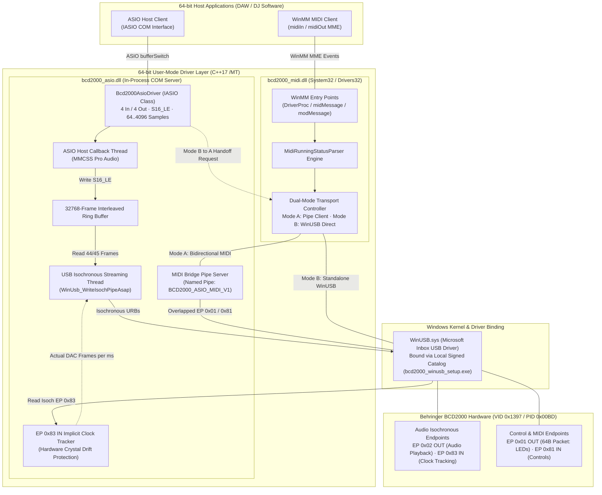

[ **English**](TECHNICS.md) | [ Español](docs/i18n/TECHNICS.es.md) | [ Português](docs/i18n/TECHNICS.pt.md) | [ Deutsch](docs/i18n/TECHNICS.de.md) | [ Français](docs/i18n/TECHNICS.fr.md) | [ 中文](docs/i18n/TECHNICS.zh.md) | [ 日本語](docs/i18n/TECHNICS.ja.md)

# Technical Reference, Architecture & Developer Guide (`TECHNICS.md`)

**Deep-dive engineering documentation for the Behringer BCD2000 64-bit User-Mode ASIO & WinMM MIDI Driver Suite.**

[User Overview (README.md)](README.md) · [Historical Verification Blueprint](docs/ROADMAP_VERIFICATION.md) · [AI Agent Guardrails (AGENTS.md)](AGENTS.md)


---

## 1. System Overview & Core Design Decisions

The **Behringer BCD2000** (`VID 0x1397`, `PID 0x00BD`) is a **USB 1.1 Full-Speed (12 Mbps)** device built around an **8051 microcontroller**, a **TI TUSB3200** USB streaming controller, and a **Cirrus Logic CS4220** codec. Its factory firmware exposes proprietary USB descriptors that are **not** compliant with USB Audio Class (UAC) or USB-MIDI standards.

Rather than writing an unsigned or EV-signed kernel-mode `.sys` driver, this project implements a **100% User-Mode 64-bit Driver Architecture** on top of Microsoft's inbox `WinUSB.sys`:

* **No Kernel Signing Barriers:** User-mode DLLs do not require EV/WHQL kernel driver certificates or Test Signing mode on Windows 10/11 x64.
* **Zero Legacy Dependencies:** Compiled strictly for `x64` (`C++17`) using the static MSVC runtime (`/MT` in [`CMakeLists.txt`](CMakeLists.txt)), ensuring `bcd2000_asio.dll` and `bcd2000_midi.dll` never fail inside any DAW process due to missing `VCRUNTIME140.dll` / `MSVCP140.dll` redistributables.
* **USB 1.1 Bandwidth Management:** Full-Speed USB (12 Mbps) imposes strict isochronous scheduling limits. Output prioritizes 4-channel 16-bit PCM (`ASIOSTInt16LSB`, 44.1 kHz: Ch 1-2 Master RCA + Ch 3-4 Phones Cue), decoupled from host ASIO buffer sizes via a lock-free/atomic ring buffer and stabilized by hardware crystal-clock tracking.

### Key Identifiers & Endpoints

| Parameter | Value / Implementation |
| :--- | :--- |
| **USB Hardware ID** | `VID_1397&PID_00BD` |
| **WinUSB Device Interface GUID** | `{DEE824EF-729B-4A0E-9C14-B7117D33A817}` |
| **ASIO Driver Name / CLSID** | `Behringer BCD2000 ASIO 64-bit` / `{B2D20000-1397-00BD-A510-000000000064}` |
| **WinMM MIDI Device Name** | `Behringer BCD2000 MIDI` (installed in `System32` & `Drivers32`) |
| **Audio Endpoints** | EP `0x02` Isochronous OUT (4 ch S16_LE @ 44.1 kHz), EP `0x83` Isochronous IN (used for implicit DAC clock tracking) |
| **Control / MIDI Endpoints** | EP `0x01` OUT (64-byte framed packets, LEDs & init), EP `0x81` IN (Running-Status MIDI events) |
| **IPC Named Pipes** | `\\.\pipe\BCD2000_ASIO_MIDI_V1` (bidirectional MIDI bridge), `\\.\pipe\BCD2000_MIDI_CTRL_V1` (WinUSB handoff `'R' -> 'K'`) |

---

## 2. Driver Architecture Diagram



---

## 3. How We Built the Driver: Engineering Phases

This project evolved from the incremental verification roadmap originally outlined in [`docs/ROADMAP_VERIFICATION.md`](docs/ROADMAP_VERIFICATION.md) into a full production driver suite. Each phase isolated one subsystem behind a dedicated diagnostic tool before integrating it into the final DLLs.

### Phase 1 — USB Enumeration & Initialization Handshake (`bcd2000_diag_usb.exe`)
* **Challenge:** The BCD2000 stays inert on USB until its 8051 MCU receives a specific 52-byte vendor control handshake on Endpoint `0x01`.
* **Implementation:** Built device discovery via `SetupDiGetClassDevsW` matching `kWinUsbGenericGuid` + `vid_1397` / `pid_00bd`, initialized `WinUSB`, and transmitted the 52-byte `kInitSequence` (derived from the Linux kernel `snd-bcd2000` driver).
* **Validation:** Confirmed pipe enumeration, clean `WinUsb_Initialize`, and hardware LED startup response.

### Phase 2 — Control Telemetry, Running Status & Bi-Directional LEDs (`bcd2000_diag_midi.exe`)
* **Challenge:** Control packets arriving on EP `0x81` IN use variable-length **MIDI Running Status** payloads inside 64-byte USB transfers, while outgoing LED updates on EP `0x01` OUT must wrap 1..61 raw MIDI bytes into a `[0x03, 0x00, len, ...]` 64-byte header without blocking concurrent reads.
* **Implementation:** Built `MidiRunningStatusParser` and `SendBcdMidiOverlapped` in [`src/common/bcd2000_usb_protocol.h`](src/common/bcd2000_usb_protocol.h), verified faders, knobs, jog wheels, and buttons (0–127), and mapped hardware LED Control Change numbers (`0xB0`, `CC 0x00..0x19`).

### Phase 3 — Isochronous PCM Streaming & Sine Synthesis (`bcd2000_diag_audio.exe`)
* **Challenge:** Streaming continuous 4-channel 16-bit PCM (`8 bytes/frame` at 44.1 kHz) over USB 1.1 Full-Speed without buffer underruns or audible glitches under Windows scheduling jitter.
* **Implementation:** Implemented multi-URB overlapped isochronous pipelines (`360 bytes/ms` max packet geometry, `16` packets/URB, `6` concurrent URBs) elevated with **MMCSS `"Pro Audio"`** (`avrt.dll` / `AVRT_PRIORITY_CRITICAL`), verified with a 440 Hz pure sine wave across Master RCA (Ch 1-2) and Front Phones (Ch 3-4).

### Phase 4 — 64-bit COM ASIO Server & Implicit Clock Tracking (`bcd2000_asio.dll`, `hostsample.exe`)
* **Challenge 1 (Buffer Geometry Mismatch):** DAWs expect power-of-2 ASIO buffer sizes (`64..4096`, preferred `512`), whereas USB 1.1 Full-Speed operates in 1 ms frames (`44.1 frames/ms`).
* **Challenge 2 (Crystal Drift Clicks):** Sending a fixed 45 frames/ms or naive fractional cadence drifts slightly against the BCD2000's physical DAC crystal, causing periodic ~2–3 Hz clicks.
* **Implementation:**
  * Built an in-process 64-bit COM server (`Bcd2000AsioDriver`, [`src/asio/dllmain_registry.cpp`](src/asio/dllmain_registry.cpp)) implementing Steinberg ASIO 2.3 (`IASIO`).
  * Decoupled the ASIO host callback thread from the USB isochronous thread using a **32,768-frame interleaved ring buffer** (`m_outRingBuffer`).
  * Added an **EP `0x83` IN Implicit Clock Tracker** thread that reads physical packet byte counts returned by the BCD2000 (`WinUsb_ReadIsochPipeAsap`), dynamically locks to the exact hardware `frames/ms` crystal rate, and drives variable `44`/`45`-frame USB packets (`WinUsb_WriteIsochPipeAsap`) with fallback to explicit frame numbering or bulk-style timing when needed.

### Phase 5 — 64-bit WinMM MIDI Driver & Seamless Dual-Mode Handoff (`bcd2000_midi.dll`, `hostsample_midi.exe`)
* **Challenge:** `WinUSB.sys` grants **exclusive handle ownership** to a single process/interface handle. If `bcd2000_midi.dll` opens WinUSB first, `bcd2000_asio.dll` fails with `ERROR_ACCESS_DENIED` / `ERROR_SHARING_VIOLATION`—and vice versa.
* **Implementation:** Engineered a **Dual-Mode Transport** across [`src/midi/bcd2000_midi_driver.cpp`](src/midi/bcd2000_midi_driver.cpp) and [`src/asio/bcd2000_asio_driver.cpp`](src/asio/bcd2000_asio_driver.cpp):
  * **Mode A (ASIO Pipe Client):** When ASIO owns WinUSB, `bcd2000_asio.dll` hosts `\\.\pipe\BCD2000_ASIO_MIDI_V1` and bridges EP `0x81` IN / EP `0x01` OUT for any number of MIDI clients.
  * **Mode B (Standalone WinUSB + Hot Handoff):** When ASIO is idle, `bcd2000_midi.dll` owns WinUSB directly and listens on `\\.\pipe\BCD2000_MIDI_CTRL_V1`. When a DAW initializes ASIO, ASIO sends `'R'`, MIDI cleanly releases WinUSB, replies `'K'`, and promotes itself to **Mode A** **without closing open WinMM handles** in the DAW.

### Phase 6 — Zero-Zadig WinUSB Installer, NSIS Packaging & Mixxx Safe Preset
* **Zero-Zadig WinUSB Binding (`bcd2000_winusb_setup.exe`):** [`tools/bcd2000_winusb_setup.cpp`](tools/bcd2000_winusb_setup.cpp) generates a `bcd2000_winusb.inf` + SHA-256 `.cat` catalog via `wintrust.dll`, signs it with an ephemeral local 2048-bit self-signed certificate installed in `LocalMachine\Root` & `TrustedPublisher`, and binds Windows' inbox `winusb.sys` via `DiInstallDriverW`.
* **Single-EXE NSIS Installer (`Behringer_BCD2000_Setup_x64.exe`):** [`installer/bcd2000_setup.nsi`](installer/bcd2000_setup.nsi) automates WinUSB binding, `bcd2000_asio.dll` COM registration, `System32\bcd2000_midi.dll` + `Drivers32` registration, diagnostic tools, and clean uninstallation.
* **Mixxx Safe Preset (`presets/mixxx/`):** [`Behringer-BCD2000-safe-scripts.js`](presets/mixxx/Behringer-BCD2000-safe-scripts.js) omits the startup full-pot-dump command (`0xB0 0x64 0x7F`) and adds per-CC **soft-takeover** so physical EQ/Master knobs left at `0` never silence Mixxx on startup.

---

## 4. Developer Environment Setup & Building from Source

### Prerequisites (Bill of Materials)
1. **OS:** Windows 10 or Windows 11 (x64).
2. **Compiler:** Visual Studio 2022 (or Build Tools 2022) with **Desktop development with C++** (`cl.exe` targeting **x64**, C++17).
3. **Windows SDK:** Windows 10/11 SDK (`10.0.19041.0` or newer) providing `winusb`, `setupapi`, `avrt`, `wintrust`, `crypt32`, `newdev`, `winmm`, and `ole32`.
4. **Build System:** CMake `3.20` or newer.
5. **Third-Party SDK:** Steinberg ASIO SDK 2.3 headers/host files placed under `third_party/asio-sdk/`.
6. **Installer Tooling (Optional):** NSIS 3.x (checked at `.tools/nsis/nsis-3.13/Bin` or system `PATH`) to enable the `bcd2000_installer` target.

### Configure & Build (PowerShell)

```powershell
# 1. Configure for 64-bit (x64 is strictly enforced by CMakeLists.txt)
# Base suite version defaults to 2.0.0; can be overridden via -DBCD2000_VERSION="X.Y.Z"
cmake -B build -A x64 -DBCD2000_VERSION="2.0.0"

# 2. Build all driver DLLs and diagnostic utilities (RelWithDebInfo or Release)
cmake --build build --config Release

# 3. (Optional) Build the single-EXE NSIS installer
cmake --build build --config Release --target bcd2000_installer
```

Build outputs are placed in `build\Release\` (or `build\RelWithDebInfo\`).

### Registering / Testing Locally

```powershell
# Register COM ASIO DLL (requires Administrator prompt)
.\scripts\install_driver.ps1 -Config Release

# Run incremental hardware/host verification tools
.\build\Release\bcd2000_diag_usb.exe
.\build\Release\bcd2000_diag_midi.exe
.\build\Release\bcd2000_diag_audio.exe --frequency 440 --duration 10
.\third_party\asio-sdk\host\pc\hostsample.exe
.\build\Release\hostsample_midi.exe

# Unregister COM ASIO DLL
.\scripts\uninstall_driver.ps1 -Config Release
```

### Runtime Diagnostics & Troubleshooting
* **Live Trace Log:** Both `bcd2000_asio.dll` and `bcd2000_midi.dll` write timestamped diagnostic lines (`pid`, `tid`, tag) via `bcd2000::TraceLog` to **`%TEMP%\bcd2000_trace.log`**.
* **USB Packet Inspection:** Use **Wireshark + USBPcap** to inspect EP `0x01` / `0x81` control frames and EP `0x02` / `0x83` isochronous URBs.
* **Common Mitigations:**
  * *WinUSB pipe open failure:* Re-run `bcd2000_winusb_setup.exe` as Administrator (or verify `VID_1397&PID_00BD` in Device Manager is bound to `WinUSB`) and replug the USB cable.
  * *USB 1.1 bus saturation / dropouts:* Connect directly to a root USB port (avoid shared hubs) and verify buffer sizes are multiples of `64` samples (`256` or `512` recommended).
  * *No MIDI/fader input:* Ensure the 52-byte `kInitSequence` was sent cleanly (`bcd2000_diag_usb.exe`).

---

## 5. Rules & Guidelines for Contributors

We warmly welcome pull requests, bug reports, hardware testing on different Windows/USB host controllers, and DAW/DJ controller presets! To keep the driver rock-solid, please follow these project rules:

### Architectural Invariants
1. **Strict 64-bit User-Mode Only:** Never introduce kernel `.sys` components or 32-bit targets (`CMakeLists.txt` intentionally aborts on non-64-bit builds).
2. **Keep Static CRT (`/MT`):** Do not switch `CMAKE_MSVC_RUNTIME_LIBRARY` to dynamic `/MD`. Driver DLLs loaded inside third-party DAW processes must remain self-contained.
3. **Real-Time Audio Thread Safety:** Inside `AsioHostThreadMain` and `UsbStreamingThreadMain`, **never** allocate memory on the heap, take blocking locks that contend with UI/IPC threads, or perform synchronous file I/O.
4. **Shared Protocol Single Source of Truth:** Keep USB VID/PID, `kInitSequence`, pipe names, `MidiRunningStatusParser`, and frame helpers centralized in [`src/common/bcd2000_usb_protocol.h`](src/common/bcd2000_usb_protocol.h).
5. **Preserve Dual-Mode WinUSB Sharing:** Any code touching WinUSB handles in ASIO or MIDI must preserve the `'R' -> 'K'` handoff protocol and Mode A/B promotion without breaking open WinMM handles.
6. **Continuous Delivery & SemVer (v2.0.0+):** Every update to `main` triggers automated builds, NSIS packaging, and tagging via GitHub Actions ([`.github/workflows/release.yml`](.github/workflows/release.yml)). The baseline starts at `v2.0.0` to avoid version collision with Behringer's legacy 32-bit drivers (`v1.x`). Commit messages drive SemVer: default pushes bump `patch`, `feat:` / `#minor` bumps `minor`, and `BREAKING CHANGE:` / `#major` bumps `major`.

### Code Style & PR Checklist
* **C++17 Cleanliness:** Compile with `/W4 /permissive- /utf-8` (`CMakeLists.txt`) with zero new compiler warnings.
* **Required Build Verification:** Verify both `RelWithDebInfo` and `Release` x64 builds succeed before opening a PR.
* **Hardware/Host Verification:**
  * Changes to ASIO COM / streaming: test with `hostsample.exe` and at least one real 64-bit DAW (e.g., REAPER, Ableton Live, or Mixxx).
  * Changes to WinMM MIDI / IPC bridge: test `hostsample_midi.exe` and simultaneous ASIO + MIDI startup/shutdown transitions.
* **Documentation Sync:** If your PR changes user-facing behavior, build steps, or presets, update [`README.md`](README.md) / [`TECHNICS.md`](TECHNICS.md) (and all translations in `docs/i18n/`).
* **AI Agent Guardrails:** Automated assistants and AI agents must review and strictly adhere to [`AGENTS.md`](AGENTS.md).

---

## 9. Licensing Architecture & Legal Compliance

The Behringer BCD2000 64-bit ASIO and MIDI Driver Suite is distributed as Free and Open Source Software under the terms of the **[GNU General Public License v3 or later (GPL-3.0-or-later)](LICENSE)**, augmented with the **ASIO & Host Application Linking Exception** (GPLv3 Section 7).

### 9.1. Clean-Room ASIO COM ABI & Host Linking Exception
* **Clean-Room ABI Definitions:** The headers in [`third_party/asio-sdk/common`](third_party/asio-sdk/common) (`asio.h`, `iasiodrv.h`) are independent clean-room declarations of the public COM ABI for Steinberg ASIO 2.3. They do not incorporate, copy, or distribute proprietary files from Steinberg's closed SDK.
* **ASIO Host Exception:** An explicit permission under GPLv3 Section 7 grants users and developers the right to dynamically link and load `bcd2000_asio.dll` and `bcd2000_midi.dll` via the IASIO COM interface and WinMM MME driver interface from any host application (such as Mixxx, Ableton Live, FL Studio, REAPER, Traktor) without imposing license obligations on the host software.
* **Trademark:** ASIO is a registered trademark and software of Steinberg Media Technologies GmbH.

### 9.2. Third-Party References & System Libraries
* **Linux ALSA Reverse-Engineering (`snd-bcd2000`):** The 52-byte USB handshake sequence (`kInitSequence`) was derived from the Linux kernel ALSA driver authored by Mario Kicherer (`GPL-2.0`). Hardware protocol constants and functional handshake data are utilized for interoperability.
* **Mixxx Safe Mapping Presets:** The controller mapping scripts in [`presets/mixxx`](presets/mixxx) are based on the original Mixxx BCD2000 preset by Golzo and the Mixxx Development Team (`GPL-2.0-or-later`), cleanly compatible with GPL-3.0-or-later.
* **Windows System Libraries Exception:** The driver relies on Microsoft Windows inbox drivers (`WinUSB.sys`), Windows SDK headers, and the statically linked MSVC runtime (`/MT`). Under Section 1 of the GNU GPLv3, these components qualify as System Libraries, permitting distribution of compiled x64 binaries without licensing encumbrance.
* **Credits:** Full authorship and reverse-engineering credits are maintained in [`AUTHORS`](AUTHORS).

---

---

[ **English**](TECHNICS.md) | [ Español](docs/i18n/TECHNICS.es.md) | [ Português](docs/i18n/TECHNICS.pt.md) | [ Deutsch](docs/i18n/TECHNICS.de.md) | [ Français](docs/i18n/TECHNICS.fr.md) | [ 中文](docs/i18n/TECHNICS.zh.md) | [ 日本語](docs/i18n/TECHNICS.ja.md)
