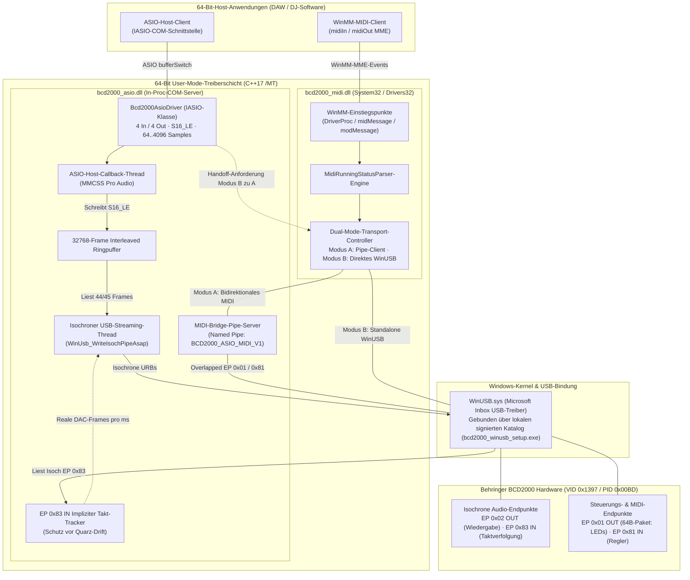

[ English](../../TECHNICS.md) | [ Español](TECHNICS.es.md) | [ Português](TECHNICS.pt.md) | [ **Deutsch**](TECHNICS.de.md) | [ Français](TECHNICS.fr.md) | [ 中文](TECHNICS.zh.md) | [ 日本語](TECHNICS.ja.md)

# Technische Referenz, Architektur & Entwicklerhandbuch (`TECHNICS.de.md`)

**Detaillierte Engineering-Dokumentation zur 64-Bit-User-Mode-ASIO- und WinMM-MIDI-Treibersuite für die Behringer BCD2000.**

[Benutzerübersicht (README.de.md)](README.de.md) · [Historischer Verifizierungsplan](../ROADMAP_VERIFICATION.md) · [KI-Agenten-Guardrails (AGENTS.md)](../../AGENTS.md)

---

## 1. Systemübersicht & zentrale Architekturentscheidungen

Die **Behringer BCD2000** (`VID 0x1397`, `PID 0x00BD`) ist ein **USB-1.1-Full-Speed-Gerät (12 Mbit/s)** auf Basis eines **8051-Mikrocontrollers**, eines **TI TUSB3200** USB-Streaming-Controllers und eines **Cirrus Logic CS4220** Codecs. Die Werk-Firmware verwendet proprietäre USB-Deskriptoren, die **nicht** mit USB Audio Class (UAC) oder USB-MIDI kompatibel sind.

Anstelle eines Kernel-Mode-`.sys`-Treibers setzt dieses Projekt auf eine **reine 64-Bit-User-Mode-Architektur** auf Basis von Microsofts integriertem `WinUSB.sys`:

* **Keine Kernel-Signaturhürden:** User-Mode-DLLs benötigen unter Windows 10/11 x64 weder EV-/WHQL-Zertifikate noch den Test-Signing-Modus.
* **Keine externen Laufzeitabhängigkeiten:** Strikt für `x64` (`C++17`) mit statischer MSVC-Runtime (`/MT` in [`CMakeLists.txt`](../../CMakeLists.txt)) kompiliert, sodass `bcd2000_asio.dll` und `bcd2000_midi.dll` in keiner DAW an fehlenden `VCRUNTIME140.dll` / `MSVCP140.dll` scheitern.
* **USB-1.1-Bandbreitenmanagement:** Full-Speed-USB (12 Mbit/s) setzt enge isochrone Grenzen. Die Ausgabe priorisiert 4-kanaliges 16-Bit-PCM (`ASIOSTInt16LSB`, 44,1 kHz: Kanäle 1-2 Master Cinch + Kanäle 3-4 Kopfhörer Cue), entkoppelt über einen atomaren Ringpuffer und stabilisiert durch implizite Hardware-Taktverfolgung.

### Wichtige Kennungen & Endpunkte

| Parameter | Wert / Implementierung |
| :--- | :--- |
| **USB Hardware-ID** | `VID_1397&PID_00BD` |
| **WinUSB-Schnittstellen-GUID** | `{DEE824EF-729B-4A0E-9C14-B7117D33A817}` |
| **ASIO-Treibername / CLSID** | `Behringer BCD2000 ASIO 64-bit` / `{B2D20000-1397-00BD-A510-000000000064}` |
| **WinMM-MIDI-Gerätename** | `Behringer BCD2000 MIDI` (in `System32` & `Drivers32`) |
| **Audio-Endpunkte** | EP `0x02` Isochron OUT (4 Kan. S16_LE @ 44,1 kHz), EP `0x83` Isochron IN (implizites DAC-Takt-Tracking) |
| **Control-/MIDI-Endpunkte** | EP `0x01` OUT (64-Byte-Frames, LEDs & Init), EP `0x81` IN (MIDI Running Status) |
| **IPC Named Pipes** | `\\.\pipe\BCD2000_ASIO_MIDI_V1` (bidirektionale MIDI-Brücke), `\\.\pipe\BCD2000_MIDI_CTRL_V1` (WinUSB-Handoff `'R' -> 'K'`) |

---

## 2. Architekturdiagramm des Treibers



---

## 3. Entwicklungsphasen: Wie der Treiber entstand

Dieses Projekt entwickelte sich aus dem ursprünglichen Verifizierungsplan in [`docs/ROADMAP_VERIFICATION.md`](../ROADMAP_VERIFICATION.md) zur heutigen vollständigen Treibersuite weiter. Jede Phase validierte ein Subsystem in einem eigenen Diagnosetool vor der finalen DLL-Integration.

### Phase 1 — USB-Enumeration & Initialisierungs-Handshake (`bcd2000_diag_usb.exe`)
* **Problem:** Die BCD2000 bleibt am USB-Bus stumm, bis der 8051-Controller einen 52-Byte-Handshake auf Endpunkt `0x01` erhält.
* **Lösung:** Geräteerkennung per `SetupDiGetClassDevsW` (`kWinUsbGenericGuid` + `vid_1397`/`pid_00bd`), `WinUsb_Initialize` und Senden von `kInitSequence` (aus `snd-bcd2000`).
* **Ergebnis:** Saubere Pipe-Enumeration und LED-Startreaktion der Konsole.

### Phase 2 — Steuerungstelemetrie, Running Status & LED-Engine (`bcd2000_diag_midi.exe`)
* **Problem:** Eingehende Pakete auf EP `0x81` IN nutzen **MIDI Running Status** variabler Länge in 64-Byte-Transfers; LED-Befehle auf EP `0x01` OUT erfordern einen `[0x03, 0x00, len, ...]`-Header ohne Blockierung.
* **Lösung:** `MidiRunningStatusParser` und `SendBcdMidiOverlapped` in [`src/common/bcd2000_usb_protocol.h`](../../src/common/bcd2000_usb_protocol.h) inklusive Verifizierung aller Regler und LED-CCs (`0xB0`, `CC 0x00..0x19`).

### Phase 3 — Isochrones PCM-Streaming & Sinuston-Test (`bcd2000_diag_audio.exe`)
* **Problem:** Kontinuierliches 4-Kanal-PCM (`8 Bytes/Frame` @ 44,1 kHz) über USB 1.1 ohne Aussetzer unter Windows-Scheduling.
* **Lösung:** Overlapped Multi-URB-Pipeline (`360 Bytes/ms` max., `16` Pakete/URB, `6` parallele URBs) unter **MMCSS `"Pro Audio"`** (`avrt.dll` / `AVRT_PRIORITY_CRITICAL`), verifiziert per 440-Hz-Sinuston auf Master Cinch und Kopfhörer.

### Phase 4 — 64-Bit-COM-ASIO-Server & implizites Takt-Tracking (`bcd2000_asio.dll`, `hostsample.exe`)
* **Problem:** ASIO-Puffer sind Zweierpotenzen (`64..4096`), USB 1.1 arbeitet in 1-ms-Frames (`44,1 Frames/ms`) — und eine starre Paketrate driftet gegen den DAC-Quarz (~2–3 Hz Knackser).
* **Lösung:** 64-Bit-COM-Server (`Bcd2000AsioDriver`, [`src/asio/dllmain_registry.cpp`](../../src/asio/dllmain_registry.cpp)), **32.768-Frame-Ringpuffer** und ein **impliziter Takt-Tracker auf EP `0x83` IN** (`WinUsb_ReadIsochPipeAsap`), der reale `Frames/ms` misst und variable `44`/`45`-Frame-Pakete dynamisch nachführt.

### Phase 5 — 64-Bit-WinMM-MIDI-Treiber & nahtloses Dual-Mode-Handoff (`bcd2000_midi.dll`, `hostsample_midi.exe`)
* **Problem:** `WinUSB.sys` erlaubt nur **exklusiven Handle-Zugriff** durch einen einzigen Besitzer.
* **Lösung:** Koordiniertes **Dual-Mode-Transportmodell** ([`src/midi/bcd2000_midi_driver.cpp`](../../src/midi/bcd2000_midi_driver.cpp) & [`src/asio/bcd2000_asio_driver.cpp`](../../src/asio/bcd2000_asio_driver.cpp)): **Modus A** nutzt `\\.\pipe\BCD2000_ASIO_MIDI_V1`, **Modus B** öffnet WinUSB direkt und übergibt den Zugriff per `'R' -> 'K'` über `\\.\pipe\BCD2000_MIDI_CTRL_V1`, ohne geöffnete DAW-MIDI-Handles zu schließen.

### Phase 6 — Zero-Zadig-Installer, NSIS-Paket & sicheres Mixxx-Preset
* **WinUSB ohne Zadig (`bcd2000_winusb_setup.exe`):** [`tools/bcd2000_winusb_setup.cpp`](../../tools/bcd2000_winusb_setup.cpp) erzeugt und signiert lokal `.inf`/`.cat` (SHA-256) über `wintrust.dll` + `DiInstallDriverW`.
* **Einzel-EXE-Installer (`Behringer_BCD2000_Setup_x64.exe`):** [`installer/bcd2000_setup.nsi`](../../installer/bcd2000_setup.nsi) installiert WinUSB, ASIO COM, `System32\bcd2000_midi.dll`, Diagnosetools und Deinstaller.
* **Sicheres Mixxx-Preset (`presets/mixxx/`):** [`Behringer-BCD2000-safe-scripts.js`](../../presets/mixxx/Behringer-BCD2000-safe-scripts.js) verzichtet auf den Initial-Dump (`0xB0 0x64 0x7F`) und aktiviert *Soft-Takeover*.

---

## 4. Build-Umgebung einrichten & kompilieren

### Voraussetzungen (Bill of Materials)
1. **OS:** Windows 10 oder Windows 11 (x64).
2. **Compiler:** Visual Studio 2022 (oder Build Tools 2022) mit **Desktopentwicklung mit C++** (`cl.exe` Ziel **x64**, C++17).
3. **Windows SDK:** Windows 10/11 SDK (`10.0.19041.0` oder neuer) mit `winusb`, `setupapi`, `avrt`, `wintrust`, `crypt32`, `newdev`, `winmm` und `ole32`.
4. **Build-System:** CMake `3.20` oder neuer.
5. **Drittanbieter-SDK:** Steinberg ASIO SDK 2.3 unter `third_party/asio-sdk/`.
6. **Installer-Werkzeug (optional):** NSIS 3.x (`.tools/nsis/nsis-3.13/Bin` oder System-`PATH`) für das Target `bcd2000_installer`.

### Konfigurieren & Kompilieren (PowerShell)

```powershell
# 1. Für 64-Bit konfigurieren (x64 wird durch CMakeLists.txt strikt erzwungen)
# Standardversion ist 2.0.0; kann über -DBCD2000_VERSION="X.Y.Z" überschrieben werden
cmake -B build -A x64 -DBCD2000_VERSION="2.0.0"

# 2. Alle Treiber-DLLs und Diagnosewerkzeuge kompilieren (RelWithDebInfo oder Release)
cmake --build build --config Release

# 3. (Optional) Den Einzel-EXE-NSIS-Installer erstellen
cmake --build build --config Release --target bcd2000_installer
```

Die Build-Ausgaben werden in `build\Release\` (oder `build\RelWithDebInfo\`) abgelegt.

### Lokales Registrieren & Testen

```powershell
# COM-ASIO-DLL registrieren (erfordert Administratorrechte)
.\scripts\install_driver.ps1 -Config Release

# Inkrementelle Hardware-/Host-Verifikationstools ausführen
.\build\Release\bcd2000_diag_usb.exe
.\build\Release\bcd2000_diag_midi.exe
.\build\Release\bcd2000_diag_audio.exe --frequency 440 --duration 10
.\third_party\asio-sdk\host\pc\hostsample.exe
.\build\Release\hostsample_midi.exe

# COM-ASIO-DLL deregistrieren
.\scripts\uninstall_driver.ps1 -Config Release
```

### Laufzeitdiagnose & Fehlerbehebung
* **Live-Trace-Log:** Sowohl `bcd2000_asio.dll` als auch `bcd2000_midi.dll` schreiben Zeitstempel-Zeilen (`pid`, `tid`, Tag) via `bcd2000::TraceLog` nach **`%TEMP%\bcd2000_trace.log`**.
* **USB-Paketanalyse:** Verwende **Wireshark + USBPcap**, um EP `0x01` / `0x81`-Steuerungsframes und EP `0x02` / `0x83`-isochrone URBs zu prüfen.
* **Typische Abhilfen:**
  * *WinUSB-Pipe-Fehler:* `bcd2000_winusb_setup.exe` als Administrator ausführen und das USB-Kabel neu einstecken.
  * *USB-1.1-Aussetzer:* Direkt am PC-Port anschließen und Puffergrößen als Vielfache von `64` wählen (`256` oder `512` empfohlen).
  * *Keine Fader-/Tasten-Events:* Sicherstellen, dass die 52-Byte-`kInitSequence` gesendet wurde (`bcd2000_diag_usb.exe`).

---

## 5. Regeln & Richtlinien für Mitwirkende

Pull Requests, Fehlerberichte, Hardware-Tests mit verschiedenen USB-Controllern und DAW-/DJ-Presets sind herzlich willkommen! Um die Stabilität zu gewährleisten, beachte bitte diese Regeln:

### Architektur-Invarianten
1. **Strikt 64-Bit User-Mode:** Niemals Kernel-`.sys`-Komponenten oder 32-Bit-Targets einführen (`CMakeLists.txt` bricht bei Nicht-x64-Builds ab).
2. **Statische CRT (`/MT`) beibehalten:** `CMAKE_MSVC_RUNTIME_LIBRARY` nicht auf `/MD` ändern. DLLs in fremden DAW-Prozessen müssen autark bleiben.
3. **Echtzeit-Sicherheit:** In `AsioHostThreadMain` und `UsbStreamingThreadMain` **niemals** Heap-Allokationen, blockierende UI/IPC-Locks oder synchrone Datei-I/O ausführen.
4. **Zentrale Protokoll-Quelle:** VID/PID, `kInitSequence`, Pipe-Namen, `MidiRunningStatusParser` und Frame-Helfer bleiben in [`src/common/bcd2000_usb_protocol.h`](../../src/common/bcd2000_usb_protocol.h).
5. **Dual-Mode-Handoff erhalten:** WinUSB-Änderungen müssen das `'R' -> 'K'`-Protokoll ohne Schließen offener WinMM-Handles einhalten.
6. **Continuous Delivery & SemVer (v2.0.0+):** Jedes Update im `main`-Branch löst automatische Builds, NSIS-Paketierung und Tagging via GitHub Actions ([`.github/workflows/release.yml`](../../.github/workflows/release.yml)) aus. Die Basisversion beginnt bei `v2.0.0`, um Verwechslungen mit den veralteten 32-Bit-Treibern von Behringer (`v1.x`) auszuschließen. Commit-Nachrichten steuern das SemVer-Inkrement: Standard-Commits erhöhen `patch`, `feat:` / `#minor` erhöht `minor` und `BREAKING CHANGE:` / `#major` erhöht `major`.

### Code-Stil & PR-Checkliste
* **Sauberes C++17:** Mit `/W4 /permissive- /utf-8` fehler- und warnungsfrei kompilieren.
* **Erforderliche Build-Verifikation:** Vor dem Eröffnen eines PRs `RelWithDebInfo` und `Release` (x64) erfolgreich kompilieren.
* **Hardware-/Host-Verifikation:**
  * ASIO-Änderungen: Mit `hostsample.exe` und mindestens einer echten 64-Bit-DAW (REAPER, Ableton Live, Mixxx) testen.
  * WinMM-MIDI-Änderungen: Mit `hostsample_midi.exe` und simultanen ASIO+MIDI-Start-/Stopp-Übergängen prüfen.
* **Dokumentations-Synchronisation:** Bei Änderungen an Verhalten, Build-Schritten oder Presets [`README.de.md`](README.de.md) / [`TECHNICS.de.md`](TECHNICS.de.md) (und alle Übersetzungen in `docs/i18n/`) aktualisieren.
* **KI-Agenten-Guardrails:** Automatisierte Assistenten und KI-Agenten müssen [`AGENTS.md`](../../AGENTS.md) zwingend beachten.

---

## 9. Lizenzarchitektur & Rechtliche Konformität

Die Behringer BCD2000 64-bit ASIO and MIDI Driver Suite wird als freie Software unter der **[GNU General Public License v3 oder neuer (GPL-3.0-or-later)](../../LICENSE)** vertrieben, ergänzt um die **ASIO & Host-Verknüpfungsausnahme** (GPLv3 Abschnitt 7).

### 9.1. Clean-Room ASIO COM ABI & Host-Verknüpfungsausnahme
* **Clean-Room ABI-Deklarationen:** Die Header in [`third_party/asio-sdk/common`](../../third_party/asio-sdk/common) (`asio.h`, `iasiodrv.h`) sind unabhängige Clean-Room-Deklarationen der öffentlichen Steinberg ASIO 2.3 COM ABI. Sie enthalten keinen proprietären Code aus Steinbergs geschlossenem SDK.
* **ASIO Host-Ausnahme:** Gemäß GPLv3 Abschnitt 7 wird Anwendern und DAW-Entwicklern ausdrücklich das Recht eingeräumt, `bcd2000_asio.dll` und `bcd2000_midi.dll` über die IASIO COM-Schnittstelle und WinMM MME dynamisch mit beliebiger Host-Software (Mixxx, Ableton Live, FL Studio, REAPER, Traktor) zu verknüpfen und zu laden, ohne der Host-Anwendung Lizenzverpflichtungen aufzuerlegen.
* **Markenhinweis:** ASIO ist ein eingetragenes Warenzeichen und Software der Steinberg Media Technologies GmbH.

### 9.2. Drittanbieter-Referenzen & Systembibliotheken
* **Linux ALSA Reverse-Engineering (`snd-bcd2000`):** Das 52-Byte-Initialisierungs-Handshake (`kInitSequence`) basiert auf der Analyse des Linux-Kernel-ALSA-Treibers von Mario Kicherer (`GPL-2.0`). Hardware-Protokollkonstanten werden zur technischen Interoperabilität verwendet.
* **Mixxx Safe-Mapping-Presets:** Die Presets in [`presets/mixxx`](../../presets/mixxx) basieren auf dem ursprünglichen Mixxx BCD2000-Mapping von Golzo und dem Mixxx Development Team (`GPL-2.0-or-later`) und sind vollständig mit GPL-3.0-or-later kompatibel.
* **Windows System Libraries-Ausnahme:** Der Treiber verwendet Windows-Inbox-Treiber (`WinUSB.sys`), Windows SDK-Header und die statische MSVC-Laufzeitumgebung (`/MT`). Gemäß Abschnitt 1 der GNU GPLv3 qualifizieren sich diese als Systembibliotheken, was die Weitergabe kompilierter x64-Binärdateien gestattet.
* **Danksagungen & Autoren:** Vollständige Angaben finden sich in [`AUTHORS`](../../AUTHORS).

---

---

[ English](../../TECHNICS.md) | [ Español](TECHNICS.es.md) | [ Português](TECHNICS.pt.md) | [ **Deutsch**](TECHNICS.de.md) | [ Français](TECHNICS.fr.md) | [ 中文](TECHNICS.zh.md) | [ 日本語](TECHNICS.ja.md)
