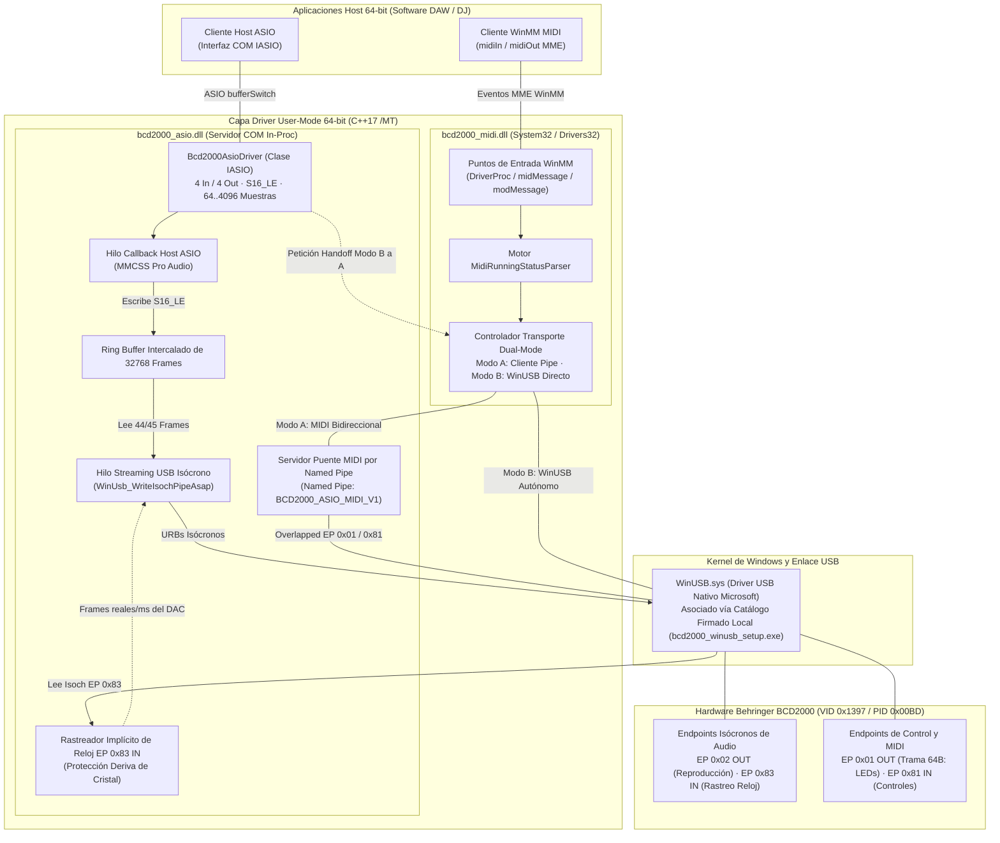

[ English](../../TECHNICS.md) | [ **Español**](TECHNICS.es.md) | [ Português](TECHNICS.pt.md) | [ Deutsch](TECHNICS.de.md) | [ Français](TECHNICS.fr.md) | [ 中文](TECHNICS.zh.md) | [ 日本語](TECHNICS.ja.md)

# Referencia Técnica, Arquitectura y Guía para Desarrolladores (`TECHNICS.es.md`)

**Documentación de ingeniería en profundidad de la suite de drivers User-Mode ASIO y WinMM MIDI de 64 bits para Behringer BCD2000.**

[Guía para Usuarios (README.es.md)](README.es.md) · [Blueprint Histórico de Verificación](../ROADMAP_VERIFICATION.md) · [Guardrails para Agentes IA (AGENTS.md)](../../AGENTS.md)


---

## 1. Visión General del Sistema y Decisiones de Diseño

La **Behringer BCD2000** (`VID 0x1397`, `PID 0x00BD`) es un dispositivo **USB 1.1 Full-Speed (12 Mbps)** basado en un **microcontrolador 8051**, un controlador USB **TI TUSB3200** y un códec **Cirrus Logic CS4220**. Su firmware de fábrica expone descriptores USB propietarios que **no** son compatibles con los estándares USB Audio Class (UAC) ni USB-MIDI.

En lugar de desarrollar un driver `.sys` en modo kernel (que exigiría certificados EV/WHQL costosos o desactivar protecciones del sistema), este proyecto implementa una **arquitectura 100 % en Modo Usuario (User-Mode) de 64 bits** apoyada en el controlador nativo `WinUSB.sys` de Microsoft:

* **Sin barreras de firma de kernel:** Las librerías dinámicas en modo usuario no requieren firma EV/WHQL ni modo Test Signing en Windows 10/11 x64.
* **Cero dependencias externas en tiempo de ejecución:** Compilado estrictamente en `x64` (`C++17`) con runtime estático MSVC (`/MT` en [`CMakeLists.txt`](../../CMakeLists.txt)), garantizando que `bcd2000_asio.dll` y `bcd2000_midi.dll` nunca fallen dentro de ningún DAW por ausencia de `VCRUNTIME140.dll` o `MSVCP140.dll`.
* **Gestión del ancho de banda USB 1.1:** El bus Full-Speed (12 Mbps) impone límites estrictos de planificación isócrona. La salida prioriza audio PCM de 4 canales y 16 bits (`ASIOSTInt16LSB`, 44.1 kHz: Canales 1-2 Master RCA + Canales 3-4 Auriculares Cue), desacoplado de los tamaños de buffer ASIO mediante un ring buffer atómico y estabilizado por seguimiento implícito del reloj hardware.

### Identificadores y Endpoints Clave

| Parámetro | Valor / Implementación |
| :--- | :--- |
| **Hardware ID USB** | `VID_1397&PID_00BD` |
| **GUID de Interfaz WinUSB** | `{DEE824EF-729B-4A0E-9C14-B7117D33A817}` |
| **Nombre / CLSID ASIO** | `Behringer BCD2000 ASIO 64-bit` / `{B2D20000-1397-00BD-A510-000000000064}` |
| **Nombre Dispositivo WinMM MIDI** | `Behringer BCD2000 MIDI` (instalado en `System32` y `Drivers32`) |
| **Endpoints de Audio** | EP `0x02` Isócrono OUT (4 ch S16_LE @ 44.1 kHz), EP `0x83` Isócrono IN (usado para rastreo implícito del reloj DAC) |
| **Endpoints Control / MIDI** | EP `0x01` OUT (tramas de 64 bytes, LEDs e init), EP `0x81` IN (eventos MIDI con Running Status) |
| **Named Pipes IPC** | `\\.\pipe\BCD2000_ASIO_MIDI_V1` (puente MIDI bidireccional), `\\.\pipe\BCD2000_MIDI_CTRL_V1` (handoff WinUSB `'R' -> 'K'`) |

---

## 2. Diagrama de Arquitectura del Driver



---

## 3. Cómo Construimos el Driver: Evolución por Fases

El proyecto evolucionó a partir de la matriz incremental definida originalmente en [`docs/ROADMAP_VERIFICATION.md`](../ROADMAP_VERIFICATION.md) hasta consolidarse en la suite completa actual. Cada fase aisló un subsistema en un binario de diagnóstico independiente antes de integrarlo en las DLLs finales.

### Fase 1 — Enumeración USB y Handshake de Activación (`bcd2000_diag_usb.exe`)
* **Reto:** La BCD2000 permanece inactiva en USB hasta que su microcontrolador 8051 recibe una secuencia específica de inicialización de 52 bytes en el Endpoint `0x01`.
* **Implementación:** Detección mediante `SetupDiGetClassDevsW` filtrando `kWinUsbGenericGuid` + `vid_1397` / `pid_00bd`, inicialización con `WinUsb_Initialize` y transmisión de `kInitSequence` (documentada en el driver Linux `snd-bcd2000`).
* **Resultado:** Enumeración correcta de interfaces/pipes y respuesta visual de LEDs en la consola.

### Fase 2 — Telemetría de Controles, Running Status y Motor de LEDs (`bcd2000_diag_midi.exe`)
* **Reto:** Los paquetes entrantes por EP `0x81` IN emplean **MIDI Running Status** de longitud variable dentro de transferencias USB de 64 bytes, mientras que las actualizaciones de LEDs por EP `0x01` OUT deben encapsular 1..61 bytes MIDI bajo la cabecera `[0x03, 0x00, len, ...]` sin bloquear lecturas concurrentes.
* **Implementación:** Creación de `MidiRunningStatusParser` y `SendBcdMidiOverlapped` en [`src/common/bcd2000_usb_protocol.h`](../../src/common/bcd2000_usb_protocol.h), validando faders, potenciómetros, jog wheels y botones (0–127) además de los CCs de LEDs (`0xB0`, `CC 0x00..0x19`).

### Fase 3 — Streaming PCM Isócrono y Síntesis de Tono (`bcd2000_diag_audio.exe`)
* **Reto:** Transmitir audio PCM continuo de 4 canales y 16 bits (`8 bytes/frame` a 44.1 kHz) sobre USB 1.1 Full-Speed sin caídas ni discontinuidades bajo el planificador de Windows.
* **Implementación:** Pipeline multi-URB overlapped (`360 bytes/ms` máx., `16` paquetes/URB, `6` URBs en vuelo) elevado mediante **MMCSS `"Pro Audio"`** (`avrt.dll` / `AVRT_PRIORITY_CRITICAL`), verificado con una onda senoidal pura de 440 Hz en salidas Master RCA (Ch 1-2) y Auriculares (Ch 3-4).

### Fase 4 — Servidor COM ASIO 64-bit y Rastreo Implícito de Reloj (`bcd2000_asio.dll`, `hostsample.exe`)
* **Reto 1 (Geometría de buffers):** Los DAWs trabajan con tamaños de buffer ASIO potencia de 2 (`64..4096`, preferido `512`), mientras que USB 1.1 Full-Speed transmite en tramas de 1 ms (`44.1 frames/ms`).
* **Reto 2 (Deriva de cristal):** Enviar una cadencia fija o fraccional teórica produce un desfase gradual respecto al cristal físico del DAC de la BCD2000, generando clics periódicos de ~2–3 Hz.
* **Implementación:**
  * Servidor COM in-process de 64 bits (`Bcd2000AsioDriver`, [`src/asio/dllmain_registry.cpp`](../../src/asio/dllmain_registry.cpp)) conforme a Steinberg ASIO 2.3 (`IASIO`).
  * Desacoplamiento entre el hilo de callback ASIO y el hilo USB isócrono mediante un **ring buffer intercalado de 32,768 frames** (`m_outRingBuffer`).
  * Hilo **Rastreador Implícito de Reloj en EP `0x83` IN** que mide los bytes reales devueltos por la BCD2000 (`WinUsb_ReadIsochPipeAsap`), se sincroniza dinámicamente a los `frames/ms` exactos del cristal físico y modula paquetes variables de `44`/`45` frames (`WinUsb_WriteIsochPipeAsap`), con fallback automático cuando es necesario.

### Fase 5 — Driver WinMM MIDI 64-bit y Puente Dual-Mode sin Conflictos (`bcd2000_midi.dll`, `hostsample_midi.exe`)
* **Reto:** `WinUSB.sys` otorga **acceso exclusivo** a un único handle. Si `bcd2000_midi.dll` abre WinUSB primero, `bcd2000_asio.dll` falla con `ERROR_ACCESS_DENIED` / `ERROR_SHARING_VIOLATION` (y viceversa).
* **Implementación:** Transporte **Dual-Mode** coordinado entre [`src/midi/bcd2000_midi_driver.cpp`](../../src/midi/bcd2000_midi_driver.cpp) y [`src/asio/bcd2000_asio_driver.cpp`](../../src/asio/bcd2000_asio_driver.cpp):
  * **Modo A (Cliente del Pipe ASIO):** Cuando ASIO posee WinUSB, `bcd2000_asio.dll` sirve `\\.\pipe\BCD2000_ASIO_MIDI_V1` y puentea EP `0x81` IN / EP `0x01` OUT hacia cualquier cliente MIDI.
  * **Modo B (WinUSB Autónomo + Handoff en Caliente):** Cuando ASIO está inactivo, `bcd2000_midi.dll` abre WinUSB directamente y escucha en `\\.\pipe\BCD2000_MIDI_CTRL_V1`. Al iniciar ASIO, este envía `'R'`, MIDI libera WinUSB al instante, responde `'K'` y pasa a **Modo A sin cerrar los handles WinMM abiertos en el DAW**.

### Fase 6 — Instalador Zero-Zadig, Paquete NSIS y Preset Seguro para Mixxx
* **Asociación WinUSB sin Zadig (`bcd2000_winusb_setup.exe`):** [`tools/bcd2000_winusb_setup.cpp`](../../tools/bcd2000_winusb_setup.cpp) genera `bcd2000_winusb.inf` + un catálogo SHA-256 `.cat` vía `wintrust.dll`, lo firma con un certificado local efímero de 2048 bits instalado en `LocalMachine\Root` y `TrustedPublisher`, y asocia `winusb.sys` mediante `DiInstallDriverW`.
* **Instalador Único NSIS (`Behringer_BCD2000_Setup_x64.exe`):** [`installer/bcd2000_setup.nsi`](../../installer/bcd2000_setup.nsi) automatiza WinUSB, registro COM de `bcd2000_asio.dll`, copia/registro de `bcd2000_midi.dll` en `System32` (`Drivers32`), herramientas de diagnóstico y desinstalador limpio.
* **Preset Seguro para Mixxx (`presets/mixxx/`):** [`Behringer-BCD2000-safe-scripts.js`](../../presets/mixxx/Behringer-BCD2000-safe-scripts.js) omite el comando de volcado inicial (`0xB0 0x64 0x7F`) y añade *soft-takeover* por CC para que las perillas físicas dejadas en `0` nunca corten el sonido al iniciar Mixxx.

---

## 4. Configuración del Entorno de Compilación

### Requisitos (Bill of Materials)
1. **Sistema Operativo:** Windows 10 o Windows 11 (x64).
2. **Compilador:** Visual Studio 2022 (o Build Tools 2022) con **Desarrollo para el escritorio con C++** (`cl.exe` destino **x64**, C++17).
3. **Windows SDK:** Windows 10/11 SDK (`10.0.19041.0` o superior) con `winusb`, `setupapi`, `avrt`, `wintrust`, `crypt32`, `newdev`, `winmm` y `ole32`.
4. **Sistema de Build:** CMake `3.20` o superior.
5. **SDK de Terceros:** Steinberg ASIO SDK 2.3 ubicado en `third_party/asio-sdk/`.
6. **Empaquetado (Opcional):** NSIS 3.x (detectado en `.tools/nsis/nsis-3.13/Bin` o en el `PATH`) para el target `bcd2000_installer`.

### Configurar y Compilar (PowerShell)

```powershell
# 1. Configurar para 64 bits (CMakeLists.txt exige arquitectura x64)
cmake -B build -A x64

# 2. Compilar DLLs del driver y herramientas de diagnóstico (Release o RelWithDebInfo)
cmake --build build --config Release

# 3. (Opcional) Generar el instalador NSIS en un solo ejecutable
cmake --build build --config Release --target bcd2000_installer
```

Los binarios compilados se generan en `build\Release\` (o `build\RelWithDebInfo\`).

### Registro y Pruebas Locales

```powershell
# Registrar el servidor COM ASIO (solicita permisos de Administrador)
.\scripts\install_driver.ps1 -Config Release

# Ejecutar herramientas de verificación incremental
.\build\Release\bcd2000_diag_usb.exe
.\build\Release\bcd2000_diag_midi.exe
.\build\Release\bcd2000_diag_audio.exe --frequency 440 --duration 10
.\third_party\asio-sdk\host\pc\hostsample.exe
.\build\Release\hostsample_midi.exe

# Desregistrar el servidor COM ASIO
.\scripts\uninstall_driver.ps1 -Config Release
```

### Diagnóstico y Mitigación de Problemas
* **Log de Traza en Vivo:** Tanto `bcd2000_asio.dll` como `bcd2000_midi.dll` registran eventos con marca temporal (`pid`, `tid`, tag) vía `bcd2000::TraceLog` en **`%TEMP%\bcd2000_trace.log`**.
* **Captura USB:** Usa **Wireshark + USBPcap** para inspeccionar tramas de control en EP `0x01` / `0x81` y URBs isócronos en EP `0x02` / `0x83`.
* **Mitigaciones habituales:**
  * *Error al abrir pipe WinUSB:* Reejecutar `bcd2000_winusb_setup.exe` como Administrador (o verificar en el Administrador de Dispositivos que `VID_1397&PID_00BD` use `WinUSB`) y reconectar el cable USB.
  * *Saturación USB 1.1 o cortes:* Conectar a un puerto USB raíz directo (evitar hubs compartidos) y usar tamaños de buffer múltiplos de `64` muestras (`256` o `512` recomendados).
  * *Sin eventos de faders/perillas:* Confirmar que la secuencia `kInitSequence` de 52 bytes se envió correctamente (`bcd2000_diag_usb.exe`).

---

## 5. Reglas y Guía para Colaborar

¡Toda contribución es bienvenida: Pull Requests, reportes de bugs, pruebas con distintas controladoras USB/Windows y nuevos presets para software DJ/DAW! Para mantener la estabilidad del driver, respeta estas reglas:

### Invariantes de Arquitectura
1. **Solo User-Mode 64 bits:** Nunca añadas drivers kernel `.sys` ni targets de 32 bits (`CMakeLists.txt` aborta intencionalmente compilaciones que no sean x64).
2. **Mantener CRT Estático (`/MT`):** No cambies `CMAKE_MSVC_RUNTIME_LIBRARY` a `/MD`. Las DLLs cargadas dentro de DAWs externos deben ser autosuficientes.
3. **Seguridad en Tiempo Real:** Dentro de `AsioHostThreadMain` y `UsbStreamingThreadMain`, **nunca** hagas asignaciones dinámicas en heap, locks bloqueantes compartidos con hilos de UI/IPC ni I/O síncrona de archivos.
4. **Fuente Única del Protocolo:** Mantén VID/PID, `kInitSequence`, nombres de pipes, `MidiRunningStatusParser` y utilidades de trama centralizados en [`src/common/bcd2000_usb_protocol.h`](../../src/common/bcd2000_usb_protocol.h).
5. **Preservar el Handoff Dual-Mode:** Cualquier cambio en manejo de WinUSB debe respetar el protocolo `'R' -> 'K'` y la promoción Modo B ↔ Modo A sin cerrar handles WinMM activos.

### Estilo de Código y Checklist de PR
* **C++17 estricto:** Debe compilar sin nuevos warnings bajo `/W4 /permissive- /utf-8`.
* **Verificación de Build:** Confirma compilación limpia en `RelWithDebInfo` y `Release` (x64) antes de abrir un PR.
* **Pruebas funcionales:**
  * Cambios en ASIO COM / audio: probar con `hostsample.exe` y al menos un DAW x64 real (REAPER, Ableton Live o Mixxx).
  * Cambios en WinMM MIDI / puente IPC: probar `hostsample_midi.exe` y transiciones simultáneas de arranque/parada ASIO + MIDI.
* **Sincronización documental:** Si un PR cambia comportamientos visibles, pasos de compilación o presets, actualiza [`README.es.md`](README.es.md) / [`TECHNICS.es.md`](TECHNICS.es.md) (y todas las traducciones en `docs/i18n/`).
* **Guardrails para Agentes IA:** Los asistentes automáticos y agentes de IA deben revisar y acatar estrictamente [`AGENTS.md`](../../AGENTS.md).

---

## 9. Arquitectura de Licenciamiento y Cumplimiento Legal

La suite de controladores Behringer BCD2000 64-bit ASIO y MIDI se distribuye como Software Libre bajo los términos de la **[GNU General Public License v3 o posterior (GPL-3.0-or-later)](../../LICENSE)**, complementada con la **Excepción de Vinculación para Hosts y DAWs** (Sección 7 de GPLv3).

### 9.1. Definiciones Clean-Room de la ABI ASIO y Excepción para Hosts
* **Definiciones de Interfaz Limpias:** Los encabezados en [`third_party/asio-sdk/common`](../../third_party/asio-sdk/common) (`asio.h`, `iasiodrv.h`) son declaraciones independientes desarrolladas en modalidad *clean-room* a partir de la especificación pública de COM para Steinberg ASIO 2.3. No incorporan, copian ni distribuyen código fuente privativo del SDK comercial de Steinberg.
* **Excepción para Hosts ASIO:** Conforme a la Sección 7 de GPLv3, se otorga permiso explícito para enlazar y cargar `bcd2000_asio.dll` y `bcd2000_midi.dll` mediante la interfaz COM IASIO y la API WinMM MME desde cualquier aplicación anfitriona (Mixxx, Ableton Live, FL Studio, REAPER, Traktor, etc.) sin imponer obligaciones de licenciamiento sobre el software anfitrión.
* **Aviso de Marca:** ASIO es una marca registrada y software de Steinberg Media Technologies GmbH.

### 9.2. Referencias Externas y Bibliotecas del Sistema
* **Ingeniería Inversa de Linux ALSA (`snd-bcd2000`):** La secuencia de 52 bytes de inicialización USB (`kInitSequence`) se derivó del análisis del controlador ALSA desarrollado por Mario Kicherer (`GPL-2.0`). Los parámetros de protocolo y datos funcionales se implementan estrictamente para interoperabilidad de hardware.
* **Mapeos Seguros de Mixxx:** Los presets ubicados en [`presets/mixxx`](../../presets/mixxx) provienen del mapeo comunitario original de Mixxx creado por Golzo y el equipo de desarrollo de Mixxx (`GPL-2.0-or-later`), plenamente compatible con GPL-3.0-or-later.
* **Excepción de System Libraries de Windows:** El controlador depende de controladores inbox de Microsoft (`WinUSB.sys`), encabezados del Windows SDK y el runtime estático de MSVC (`/MT`). Según la Sección 1 de la GPLv3, estos elementos califican como Bibliotecas del Sistema, permitiendo la distribución legal de binarios compilados x64.
* **Créditos:** La lista completa de autores y reconocimientos se documenta en [`AUTHORS`](../../AUTHORS).

---

---

[ English](../../TECHNICS.md) | [ **Español**](TECHNICS.es.md) | [ Português](TECHNICS.pt.md) | [ Deutsch](TECHNICS.de.md) | [ Français](TECHNICS.fr.md) | [ 中文](TECHNICS.zh.md) | [ 日本語](TECHNICS.ja.md)
