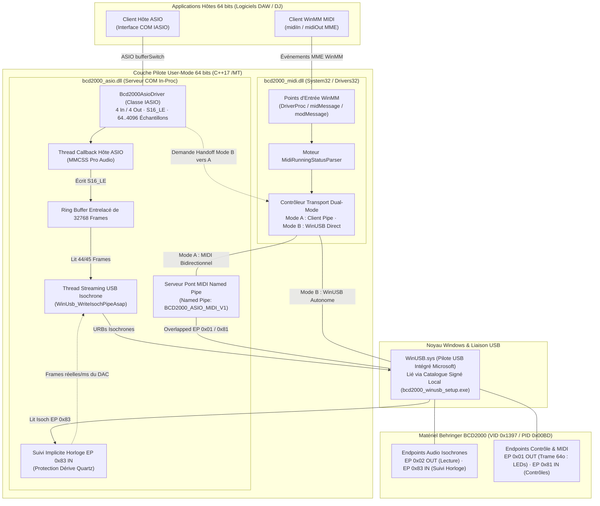

[ English](../../TECHNICS.md) | [ Español](TECHNICS.es.md) | [ Português](TECHNICS.pt.md) | [ Deutsch](TECHNICS.de.md) | [ **Français**](TECHNICS.fr.md) | [ 中文](TECHNICS.zh.md) | [ 日本語](TECHNICS.ja.md)

# Référence Technique, Architecture & Guide Développeur (`TECHNICS.fr.md`)

**Documentation d'ingénierie approfondie de la suite de pilotes User-Mode ASIO et WinMM MIDI 64 bits pour la Behringer BCD2000.**

[Présentation Utilisateur (README.fr.md)](README.fr.md) · [Plan Historique de Vérification](../ROADMAP_VERIFICATION.md) · [Guardrails pour Agents IA (AGENTS.md)](../../AGENTS.md)

---

## 1. Vue d'Ensemble & Choix d'Architecture

La **Behringer BCD2000** (`VID 0x1397`, `PID 0x00BD`) est un périphérique **USB 1.1 Full-Speed (12 Mbit/s)** architecturé autour d'un **microcontrôleur 8051**, d'un contrôleur USB **TI TUSB3200** et d'un codec **Cirrus Logic CS4220**. Son firmware d'usine expose des descripteurs USB propriétaires **non** conformes aux standards USB Audio Class (UAC) ou USB-MIDI.

Plutôt qu'un pilote noyau `.sys`, ce projet implémente une **architecture 100 % User-Mode 64 bits** au-dessus du pilote natif `WinUSB.sys` de Microsoft :

* **Aucune contrainte de signature noyau :** Les DLL en mode utilisateur ne requièrent ni certificat EV/WHQL ni mode Test Signing sous Windows 10/11 x64.
* **Zéro dépendance runtime externe :** Compilé strictement en `x64` (`C++17`) avec le runtime MSVC statique (`/MT` dans [`CMakeLists.txt`](../../CMakeLists.txt)), évitant toute erreur liée à `VCRUNTIME140.dll` / `MSVCP140.dll` dans les DAW hôtes.
* **Gestion de bande passante USB 1.1 :** Le bus Full-Speed (12 Mbit/s) impose des limites strictes. La sortie privilégie le PCM 4 canaux 16 bits (`ASIOSTInt16LSB`, 44,1 kHz : Canaux 1-2 Master RCA + Canaux 3-4 Casque Cue), découplé des tailles de buffer ASIO par un ring buffer atomique et stabilisé par suivi d'horloge matériel.

### Identifiants & Endpoints Clés

| Paramètre | Valeur / Implémentation |
| :--- | :--- |
| **Hardware ID USB** | `VID_1397&PID_00BD` |
| **GUID d'Interface WinUSB** | `{DEE824EF-729B-4A0E-9C14-B7117D33A817}` |
| **Nom / CLSID ASIO** | `Behringer BCD2000 ASIO 64-bit` / `{B2D20000-1397-00BD-A510-000000000064}` |
| **Nom Périphérique WinMM MIDI** | `Behringer BCD2000 MIDI` (installé dans `System32` & `Drivers32`) |
| **Endpoints Audio** | EP `0x02` Isochrone OUT (4 can. S16_LE @ 44,1 kHz), EP `0x83` Isochrone IN (suivi implicite d'horloge DAC) |
| **Endpoints Contrôle / MIDI** | EP `0x01` OUT (trames 64 octets, LEDs & init), EP `0x81` IN (MIDI Running Status) |
| **Named Pipes IPC** | `\\.\pipe\BCD2000_ASIO_MIDI_V1` (pont MIDI bidirectionnel), `\\.\pipe\BCD2000_MIDI_CTRL_V1` (handoff WinUSB `'R' -> 'K'`) |

---

## 2. Diagramme d'Architecture du Pilote



---

## 3. Comment Nous Avons Construit le Pilote : Phases d'Ingénierie

Ce projet a évolué depuis le plan incrémental de [`docs/ROADMAP_VERIFICATION.md`](../ROADMAP_VERIFICATION.md) jusqu'à la suite complète actuelle. Chaque phase a isolé un sous-système dans un outil de diagnostic avant son intégration finale.

### Phase 1 — Énumération USB & Handshake d'Initialisation (`bcd2000_diag_usb.exe`)
* **Défi :** Le microcontrôleur 8051 de la BCD2000 reste inactif tant qu'il ne reçoit pas une séquence propriétaire de 52 octets sur l'Endpoint `0x01`.
* **Réalisation :** Détection via `SetupDiGetClassDevsW` (`kWinUsbGenericGuid` + `vid_1397`/`pid_00bd`), `WinUsb_Initialize` et envoi de `kInitSequence` (issue de `snd-bcd2000`).
* **Validation :** Énumération des interfaces et confirmation visuelle du démarrage des LEDs.

### Phase 2 — Télémétrie des Contrôles, Running Status & Moteur LED (`bcd2000_diag_midi.exe`)
* **Défi :** Les paquets sur EP `0x81` IN utilisent le **MIDI Running Status** dans des trames de 64 octets ; les LEDs sur EP `0x01` OUT exigent un en-tête `[0x03, 0x00, len, ...]` sans bloquer les lectures.
* **Réalisation :** `MidiRunningStatusParser` et `SendBcdMidiOverlapped` dans [`src/common/bcd2000_usb_protocol.h`](../../src/common/bcd2000_usb_protocol.h), validant faders, potards, jogs, boutons et CCs de LEDs (`0xB0`, `CC 0x00..0x19`).

### Phase 3 — Streaming PCM Isochrone & Synthèse Sinusoïdale (`bcd2000_diag_audio.exe`)
* **Défi :** Flux continu 4 canaux 16 bits (`8 octets/frame` @ 44,1 kHz) sur USB 1.1 sans décrochage sous l'ordonnanceur Windows.
* **Réalisation :** Pipeline multi-URB overlapped (`360 o/ms` max., `16` paquets/URB, `6` URBs simultanés) sous **MMCSS `"Pro Audio"`** (`avrt.dll` / `AVRT_PRIORITY_CRITICAL`), validé par une sinusoïde pure à 440 Hz sur Master RCA et Casque.

### Phase 4 — Serveur COM ASIO 64 bits & Suivi Implicite d'Horloge (`bcd2000_asio.dll`, `hostsample.exe`)
* **Défi :** Les DAW utilisent des buffers puissance de 2 (`64..4096`) alors que l'USB 1.1 fonctionne par trames de 1 ms (`44,1 frames/ms`), et une cadence fixe dérive face au quartz du DAC (~2–3 Hz de clics).
* **Réalisation :** Serveur COM x64 (`Bcd2000AsioDriver`, [`src/asio/dllmain_registry.cpp`](../../src/asio/dllmain_registry.cpp)), **ring buffer de 32 768 frames**, et **suivi implicite d'horloge sur EP `0x83` IN** (`WinUsb_ReadIsochPipeAsap`) adaptant dynamiquement les paquets de `44`/`45` frames.

### Phase 5 — Pilote WinMM MIDI 64 bits & Handoff Dual-Mode (`bcd2000_midi.dll`, `hostsample_midi.exe`)
* **Défi :** `WinUSB.sys` impose un **accès exclusif** à un seul handle.
* **Réalisation :** Transport **Dual-Mode** ([`src/midi/bcd2000_midi_driver.cpp`](../../src/midi/bcd2000_midi_driver.cpp) & [`src/asio/bcd2000_asio_driver.cpp`](../../src/asio/bcd2000_asio_driver.cpp)) : **Mode A** (client de `\\.\pipe\BCD2000_ASIO_MIDI_V1`) et **Mode B** (WinUSB autonome avec handoff `'R' -> 'K'` via `\\.\pipe\BCD2000_MIDI_CTRL_V1`) sans fermer les handles WinMM ouverts dans la DAW.

### Phase 6 — Installateur Sans Zadig, Package NSIS & Preset Sécurisé Mixxx
* **Liaison WinUSB sans Zadig (`bcd2000_winusb_setup.exe`) :** [`tools/bcd2000_winusb_setup.cpp`](../../tools/bcd2000_winusb_setup.cpp) génère et signe localement `.inf`/`.cat` (SHA-256) via `wintrust.dll` + `DiInstallDriverW`.
* **Installateur Unique NSIS (`Behringer_BCD2000_Setup_x64.exe`) :** [`installer/bcd2000_setup.nsi`](../../installer/bcd2000_setup.nsi) automatise WinUSB, ASIO COM, `System32\bcd2000_midi.dll`, outils et désinstallation.
* **Preset Sécurisé Mixxx (`presets/mixxx/`) :** [`Behringer-BCD2000-safe-scripts.js`](../../presets/mixxx/Behringer-BCD2000-safe-scripts.js) supprime le dump initial (`0xB0 0x64 0x7F`) et active le *soft-takeover*.

---

## 4. Configuration de l'Environnement de Compilation

### Prérequis (Bill of Materials)
1. **OS :** Windows 10 ou Windows 11 (x64).
2. **Compilateur :** Visual Studio 2022 (ou Build Tools 2022) avec **Développement Desktop en C++** (`cl.exe` cible **x64**, C++17).
3. **Windows SDK :** Windows 10/11 SDK (`10.0.19041.0` ou supérieur) avec `winusb`, `setupapi`, `avrt`, `wintrust`, `crypt32`, `newdev`, `winmm` et `ole32`.
4. **Build System :** CMake `3.20` ou supérieur.
5. **SDK Tiers :** Steinberg ASIO SDK 2.3 placé sous `third_party/asio-sdk/`.
6. **Outils d'Installation (Optionnel) :** NSIS 3.x (`.tools/nsis/nsis-3.13/Bin` ou `PATH`) pour activer la cible `bcd2000_installer`.

### Configuration & Compilation (PowerShell)

```powershell
# 1. Configurer pour le 64 bits (x64 strictement requis par CMakeLists.txt)
# La version par défaut est 2.0.0; personnalisable via -DBCD2000_VERSION="X.Y.Z"
cmake -B build -A x64 -DBCD2000_VERSION="2.0.0"

# 2. Compiler toutes les DLL et utilitaires de diagnostic (Release ou RelWithDebInfo)
cmake --build build --config Release

# 3. (Optionnel) Générer l'installateur NSIS en un seul exécutable
cmake --build build --config Release --target bcd2000_installer
```

Les binaires sont générés dans `build\Release\` (ou `build\RelWithDebInfo\`).

### Enregistrement & Tests Locaux

```powershell
# Enregistrer le serveur COM ASIO (invite Administrateur requise)
.\scripts\install_driver.ps1 -Config Release

# Exécuter les outils de vérification incrémentale
.\build\Release\bcd2000_diag_usb.exe
.\build\Release\bcd2000_diag_midi.exe
.\build\Release\bcd2000_diag_audio.exe --frequency 440 --duration 10
.\third_party\asio-sdk\host\pc\hostsample.exe
.\build\Release\hostsample_midi.exe

# Désenregistrer le serveur COM ASIO
.\scripts\uninstall_driver.ps1 -Config Release
```

### Diagnostic & Dépannage
* **Journal Temps Réel :** `bcd2000_asio.dll` et `bcd2000_midi.dll` écrivent des lignes horodatées (`pid`, `tid`, tag) via `bcd2000::TraceLog` dans **`%TEMP%\bcd2000_trace.log`**.
* **Inspection USB :** Utilisez **Wireshark + USBPcap** pour inspecter les trames de contrôle sur EP `0x01` / `0x81` et les URBs isochrones sur EP `0x02` / `0x83`.
* **Solutions courantes :**
  * *Échec d'ouverture du pipe WinUSB :* Relancer `bcd2000_winusb_setup.exe` en Administrateur et rebrancher le câble USB.
  * *Saturation USB 1.1 ou décrochages :* Brancher sur un port USB direct et régler les tailles de buffer sur un multiple de `64` échantillons (`256` ou `512` recommandés).
  * *Aucun événement de fader/bouton :* Vérifier l'envoi de la séquence `kInitSequence` (`bcd2000_diag_usb.exe`).

---

## 5. Règles & Directives pour les Contributeurs

Toute contribution est la bienvenue : Pull Requests, rapports de bugs, tests sur différents contrôleurs USB/Windows et nouveaux presets de DAW/DJ ! Pour préserver la stabilité du pilote, suivez ces règles :

### Invariants d'Architecture
1. **Strictement 64 bits User-Mode :** N'introduisez aucun pilote noyau `.sys` ni cible 32 bits (`CMakeLists.txt` avorte sur les builds non-x64).
2. **Conserver le CRT Statique (`/MT`) :** Ne basculez pas `CMAKE_MSVC_RUNTIME_LIBRARY` vers `/MD`. Les DLL chargées dans des DAW externes doivent rester autonomes.
3. **Sécurité Temps Réel :** Dans `AsioHostThreadMain` et `UsbStreamingThreadMain`, **jamais** d'allocations heap, de verrous bloquants avec l'UI/IPC ou d'I/O fichier synchrone.
4. **Source Unique du Protocole :** Gardez constantes et parseurs centralisés dans [`src/common/bcd2000_usb_protocol.h`](../../src/common/bcd2000_usb_protocol.h).
5. **Préserver le Handoff Dual-Mode :** Toute modification de WinUSB doit respecter le protocole `'R' -> 'K'` sans fermer les handles WinMM actifs.
6. **Livraison Continue et SemVer (v2.0.0+) :** Chaque mise à jour sur la branche `main` déclenche automatiquement compilation, empaquetage NSIS et publication de tag sous GitHub Actions ([`.github/workflows/release.yml`](../../.github/workflows/release.yml)). La version de base commence à `v2.0.0` pour éviter toute confusion avec les anciens pilotes 32 bits de Behringer (`v1.x`). Les messages de commit pilotent les versions : incrément `patch` par défaut, `feat:` / `#minor` pour `minor`, et `BREAKING CHANGE:` / `#major` pour `major`.

### Style de Code & Checklist PR
* **C++17 Strict :** Compilation sans nouvel avertissement sous `/W4 /permissive- /utf-8`.
* **Vérification de Build :** Confirmer le succès des builds `RelWithDebInfo` et `Release` (x64) avant d'ouvrir une PR.
* **Vérification Matérielle/Hôte :**
  * Modifications ASIO : Tester avec `hostsample.exe` et au moins une vraie DAW x64 (REAPER, Ableton Live ou Mixxx).
  * Modifications WinMM MIDI : Tester avec `hostsample_midi.exe` et les transitions simultanées d'arrêt/démarrage ASIO+MIDI.
* **Synchronisation Documentaire :** En cas de modification de comportement, build ou presets, mettre à jour [`README.fr.md`](README.fr.md) / [`TECHNICS.fr.md`](TECHNICS.fr.md) (et toutes les traductions dans `docs/i18n/`).
* **Guardrails pour Agents IA :** Les assistants automatiques et agents IA doivent obligatoirement respecter [`AGENTS.md`](../../AGENTS.md).

---

## 9. Architecture de Licence et Conformité Juridique

La suite de pilotes Behringer BCD2000 64-bit ASIO and MIDI est distribuée en tant que logiciel libre sous la licence **[GNU General Public License v3 ou ultérieure (GPL-3.0-or-later)](../../LICENSE)**, assortie de l'**Exception de Liaison pour DAWs et Hôtes** (GPLv3 Section 7).

### 9.1. Déclarations Clean-Room de l'ABI ASIO & Exception pour Hôtes
* **Déclarations ABI Clean-Room :** Les en-têtes dans [`third_party/asio-sdk/common`](../../third_party/asio-sdk/common) (`asio.h`, `iasiodrv.h`) sont des déclarations propres et indépendantes de la spécification COM publique de Steinberg ASIO 2.3. Ils ne contiennent aucun code propriétaire issu du SDK fermé de Steinberg.
* **Exception pour Hôtes ASIO :** Conformément à la Section 7 de la GPLv3, une permission explicite autorise le chargement dynamique et la liaison de `bcd2000_asio.dll` et `bcd2000_midi.dll` via l'interface COM IASIO et WinMM MME depuis toute application hôte (Mixxx, Ableton Live, FL Studio, REAPER, Traktor) sans imposer de contraintes de licence sur l'application hôte.
* **Avis de Marque :** ASIO est une marque déposée et un logiciel de Steinberg Media Technologies GmbH.

### 9.2. Références Externes et Bibliothèques Système
* **Rétro-ingénierie Linux ALSA (`snd-bcd2000`) :** Le handshake d'initialisation de 52 octets (`kInitSequence`) est issu de l'analyse du pilote ALSA développé par Mario Kicherer (`GPL-2.0`). Les constantes de protocole et données fonctionnelles sont utilisées à des fins d'interopérabilité technique.
* **Mappages Sécurisés pour Mixxx :** Les scripts dans [`presets/mixxx`](../../presets/mixxx) s'appuient sur le mappage initial de Golzo et de l'équipe Mixxx (`GPL-2.0-or-later`), entièrement compatible avec la GPL-3.0-or-later.
* **Exception des Bibliothèques Système Windows :** Le pilote repose sur les composants natifs de Windows (`WinUSB.sys`), le SDK Windows et le runtime statique de MSVC (`/MT`). Au titre de la Section 1 de la GPLv3, ces composants sont qualifiés de Bibliothèques Système, autorisant la distribution des binaires x64.
* **Crédits :** La liste complète des auteurs et contributions est tenue à jour dans [`AUTHORS`](../../AUTHORS).

---

---

[ English](../../TECHNICS.md) | [ Español](TECHNICS.es.md) | [ Português](TECHNICS.pt.md) | [ Deutsch](TECHNICS.de.md) | [ **Français**](TECHNICS.fr.md) | [ 中文](TECHNICS.zh.md) | [ 日本語](TECHNICS.ja.md)
