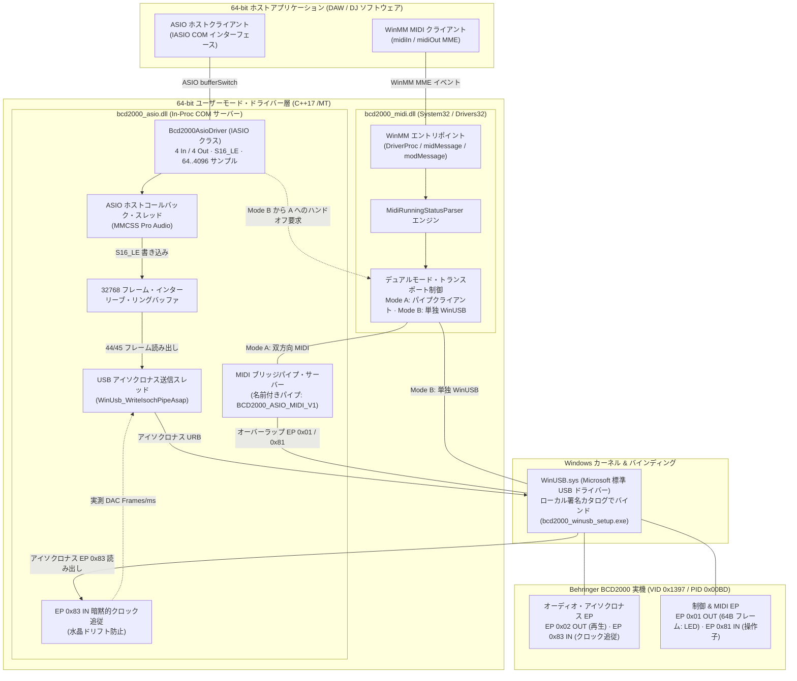

[ English](../../TECHNICS.md) | [ Español](TECHNICS.es.md) | [ Português](TECHNICS.pt.md) | [ Deutsch](TECHNICS.de.md) | [ Français](TECHNICS.fr.md) | [ 中文](TECHNICS.zh.md) | [ **日本語**](TECHNICS.ja.md)

# 技術リファレンス、アーキテクチャ & 開発者ガイド (`TECHNICS.ja.md`)

**Behringer BCD2000 64-bit ユーザーモード ASIO & WinMM MIDI ドライバー・スイートの詳細設計ドキュメント。**

[ユーザーガイド (README.ja.md)](README.ja.md) · [初期検証ブループリント](../ROADMAP_VERIFICATION.md) · [AI エージェント規範 (AGENTS.md)](../../AGENTS.md)

---

## 1. システム概要と基本設計方針

**Behringer BCD2000**（`VID 0x1397`、`PID 0x00BD`）は、**8051 マイコン**、**TI TUSB3200** USB ストリーミングコントローラー、および **Cirrus Logic CS4220** コーデックを搭載した **USB 1.1 Full-Speed（12 Mbps）** デバイスです。工場出荷時ファームウェアは独自の USB ディスクリプターを公開しており、標準の USB Audio Class（UAC）や USB-MIDI には**非対応**です。

本プロジェクトでは、EV/WHQL 署名を要するカーネルモード `.sys` ドライバーではなく、Microsoft 標準搭載の `WinUSB.sys` 上に構築した **100% ユーザーモード 64-bit アーキテクチャ**を採用しています：

* **カーネル署名の障壁なし：** ユーザーモード DLL は Windows 10/11 x64 において EV/WHQL 証明書やテスト署名モードを必要としません。
* **外部ランタイム依存ゼロ：** [`CMakeLists.txt`](../../CMakeLists.txt) にて `x64`（`C++17`）および静的 MSVC ランタイム（`/MT`）を強制しており、あらゆる DAW プロセス内で `VCRUNTIME140.dll` / `MSVCP140.dll` 不足による読み込み失敗を防ぎます。
* **USB 1.1 帯域制御：** Full-Speed（12 Mbps）の厳格なアイソクロナス制約下で、4ch 16-bit PCM（`ASIOSTInt16LSB`、44.1 kHz：Ch 1-2 Master RCA + Ch 3-4 Phones Cue）を優先出力。原子リングバッファによるバッファ長分離とハードウェア・クロック追従で安定再生を実現しています。

### 主要識別子 & エンドポイント

| 項目 | 値 / 実装 |
| :--- | :--- |
| **USB ハードウェア ID** | `VID_1397&PID_00BD` |
| **WinUSB インターフェース GUID** | `{DEE824EF-729B-4A0E-9C14-B7117D33A817}` |
| **ASIO ドライバー名 / CLSID** | `Behringer BCD2000 ASIO 64-bit` / `{B2D20000-1397-00BD-A510-000000000064}` |
| **WinMM MIDI デバイス名** | `Behringer BCD2000 MIDI`（`System32` & `Drivers32` に登録） |
| **オーディオ EP** | EP `0x02` アイソクロナス OUT（4ch S16_LE @ 44.1 kHz）、EP `0x83` アイソクロナス IN（暗黙的 DAC クロック追従用） |
| **制御 / MIDI EP** | EP `0x01` OUT（64 バイトフレーム、LED & 初期化）、EP `0x81` IN（Running-Status MIDI イベント） |
| **IPC 名前付きパイプ** | `\\.\pipe\BCD2000_ASIO_MIDI_V1`（双方向 MIDI ブリッジ）、`\\.\pipe\BCD2000_MIDI_CTRL_V1`（WinUSB ハンドオフ `'R' -> 'K'`） |

---

## 2. ドライバー・アーキテクチャ図



---

## 3. 開発の歩み：フェーズ別エンジニアリング詳細

本プロジェクトは [`docs/ROADMAP_VERIFICATION.md`](../ROADMAP_VERIFICATION.md) の段階的検証計画から発展し、現在の完全版スイートへと進化しました。各フェーズで個別診断ツールを用いてサブシステムを検証してから最終 DLL へ統合しています。

### フェーズ 1 — USB 列挙と初期化ハンドシェイク（`bcd2000_diag_usb.exe`）
* **課題：** BCD2000 は EP `0x01` で 52 バイトの独自初期化シーケンスを受信するまで応答しません。
* **実装：** `SetupDiGetClassDevsW`（`kWinUsbGenericGuid` + `vid_1397` / `pid_00bd`）による検出、`WinUsb_Initialize`、および `snd-bcd2000` 由来の `kInitSequence` 送信を実装しました。
* **検証：** パイプ列挙が成功し、本体 LED の初期点灯を確認。

### フェーズ 2 — 操作子テレメトリ、Running Status & 双方向 LED（`bcd2000_diag_midi.exe`）
* **課題：** EP `0x81` IN は 64 バイトパケット内の可変長 **MIDI Running Status** を用い、EP `0x01` OUT の LED 更新は受信をブロックせず `[0x03, 0x00, len, ...]` でラップする必要があります。
* **実装：** [`src/common/bcd2000_usb_protocol.h`](../../src/common/bcd2000_usb_protocol.h) に `MidiRunningStatusParser` と `SendBcdMidiOverlapped` を実装し、全操作子と LED CC（`0xB0`, `CC 0x00..0x19`）を検証しました。

### フェーズ 3 — アイソクロナス PCM 送信 & 正弦波テスト（`bcd2000_diag_audio.exe`）
* **課題：** Windows スケジューラ下で USB 1.1 経由の 4ch 16-bit PCM（`8 bytes/frame` @ 44.1 kHz）を途切れなく連続送信すること。
* **実装：** **MMCSS `"Pro Audio"`**（`avrt.dll` / `AVRT_PRIORITY_CRITICAL`）優先度でマルチ URB オーバーラップパイプライン（最大 `360 bytes/ms`、`16` パケット/URB、`6` 並列 URB）を構築し、440 Hz 正弦波を Master RCA とヘッドホンで確認しました。

### フェーズ 4 — 64-bit COM ASIO サーバー & 暗黙的クロック追従（`bcd2000_asio.dll`、`hostsample.exe`）
* **課題：** DAW の 2 のべき乗バッファ（`64..4096`）と USB 1.1 の 1 ms 枠（`44.1 frames/ms`）の差異、および DAC 水晶とのクロックドリフトによる約 2–3 Hz のクリックノイズ。
* **実装：** 64-bit COM サーバー（`Bcd2000AsioDriver`、[`src/asio/dllmain_registry.cpp`](../../src/asio/dllmain_registry.cpp)）、**32,768 フレーム・リングバッファ**、そして EP `0x83` IN のパケット長から実測 `frames/ms` を動的ロックして `44`/`45` フレーム送信を行う**暗黙的クロック追従スレッド**を実装しました。

### フェーズ 5 — 64-bit WinMM MIDI ドライバー & シームレスなデュアルモード切替（`bcd2000_midi.dll`、`hostsample_midi.exe`）
* **課題：** `WinUSB.sys` は単一ハンドルによる**排他所有**しか許可しません。
* **実装：** [`src/midi/bcd2000_midi_driver.cpp`](../../src/midi/bcd2000_midi_driver.cpp) と [`src/asio/bcd2000_asio_driver.cpp`](../../src/asio/bcd2000_asio_driver.cpp) 間で **Dual-Mode 転送**を構築。DAW が開いた WinMM ハンドルを閉じることなく、`\\.\pipe\BCD2000_MIDI_CTRL_V1` 経由の `'R' -> 'K'` ハンドオフで Mode B から Mode A（`\\.\pipe\BCD2000_ASIO_MIDI_V1`）へ即座に切り替えます。

### フェーズ 6 — Zadig 不要インストーラー、NSIS パッケージ & Mixxx セーフ・プリセット
* **Zadig 不要の WinUSB 導入（`bcd2000_winusb_setup.exe`）：** [`tools/bcd2000_winusb_setup.cpp`](../../tools/bcd2000_winusb_setup.cpp) が `wintrust.dll` で SHA-256 `.inf`/`.cat` を生成・ローカル署名し、`DiInstallDriverW` で自動適用します。
* **単一 EXE インストーラー（`Behringer_BCD2000_Setup_x64.exe`）：** [`installer/bcd2000_setup.nsi`](../../installer/bcd2000_setup.nsi) が WinUSB、ASIO COM、`System32\bcd2000_midi.dll`、診断ツール、アンインストーラーを一括導入します。
* **Mixxx セーフ・プリセット（`presets/mixxx/`）：** [`Behringer-BCD2000-safe-scripts.js`](../../presets/mixxx/Behringer-BCD2000-safe-scripts.js) は起動時一括ダンプ（`0xB0 0x64 0x7F`）を省き、各 CC に *soft-takeover* を適用します。

---

## 4. ビルド環境の構築とコンパイル手順

### 必要環境 (Bill of Materials)
1. **OS：** Windows 10 または Windows 11 (x64)。
2. **コンパイラ：** Visual Studio 2022（または Build Tools 2022）、**C++ によるデスクトップ開発**（`cl.exe` ターゲット **x64**、C++17）。
3. **Windows SDK：** `10.0.19041.0` 以上（`winusb`, `setupapi`, `avrt`, `wintrust`, `crypt32`, `newdev`, `winmm`, `ole32`）。
4. **ビルドツール：** CMake `3.20` 以上。
5. **サードパーティ SDK：** Steinberg ASIO SDK 2.3（`third_party/asio-sdk/` に配置）。
6. **インストーラー作成（任意）：** NSIS 3.x（`.tools/nsis/nsis-3.13/Bin` または `PATH`）、`bcd2000_installer` ターゲット用。

### ビルド手順 (PowerShell)

```powershell
# 1. 64-bit 向けに構成（CMakeLists.txt により x64 以外はエラー停止）
# デフォルトバージョンは 2.0.0 です（-DBCD2000_VERSION="X.Y.Z" で上書き可能）
cmake -B build -A x64 -DBCD2000_VERSION="2.0.0"

# 2. 全ドライバー DLL および診断ツールをビルド（Release または RelWithDebInfo）
cmake --build build --config Release

# 3. (任意) 単一 EXE の NSIS インストーラーをビルド
cmake --build build --config Release --target bcd2000_installer
```

出力バイナリは `build\Release\`（または `build\RelWithDebInfo\`）に生成されます。

### ローカル登録・検証手順

```powershell
# COM ASIO DLL を登録（管理者特権プロンプトが必要）
.\scripts\install_driver.ps1 -Config Release

# 各段階のハードウェア／ホスト検証ツールを実行
.\build\Release\bcd2000_diag_usb.exe
.\build\Release\bcd2000_diag_midi.exe
.\build\Release\bcd2000_diag_audio.exe --frequency 440 --duration 10
.\third_party\asio-sdk\host\pc\hostsample.exe
.\build\Release\hostsample_midi.exe

# COM ASIO DLL を登録解除
.\scripts\uninstall_driver.ps1 -Config Release
```

### 実行時診断とトラブルシューティング
* **リアルタイムトレース：** `bcd2000_asio.dll` および `bcd2000_midi.dll` は `bcd2000::TraceLog` を通じてタイムスタンプ行（`pid`, `tid`, tag）を **`%TEMP%\bcd2000_trace.log`** に記録します。
* **USB パケット解析：** **Wireshark + USBPcap** で EP `0x01` / `0x81` 制御フレームおよび EP `0x02` / `0x83` アイソクロナス URB を検査できます。
* **主な対処法：**
  * *WinUSB パイプ開放エラー：* 管理者として `bcd2000_winusb_setup.exe` を再実行し、USB ケーブルを再接続します。
  * *USB 1.1 帯域逼迫・音切れ：* PC 本体直結ポートを使用し、バッファ長を `64` の倍数（`256` または `512` 推奨）に設定します。
  * *操作子イベントなし：* 52 バイトの初期化シーケンス `kInitSequence` が送出されたか確認します（`bcd2000_diag_usb.exe`）。

---

## 5. コントリビューター向け開発ルール

プルリクエスト、不具合報告、各種 USB ホスト／Windows バージョンでの検証、新しい DAW／DJ マッピングの提供を心より歓迎します。ドライバーの堅牢性を保つため、以下の規則を厳守してください：

### アーキテクチャ不変条件
1. **厳格な 64-bit ユーザーモード専用：** カーネル `.sys` コンポーネントや 32-bit ターゲットの追加は禁止です（`CMakeLists.txt` は非 64-bit ビルドを自動中断します）。
2. **静的 CRT（`/MT`）の維持：** `CMAKE_MSVC_RUNTIME_LIBRARY` を `/MD` に変更しないでください。外部 DAW で読み込まれる DLL は完全自己完結している必要があります。
3. **リアルタイム安全性の遵守：** `AsioHostThreadMain` および `UsbStreamingThreadMain` 内でのヒープ確保、UI/IPC 競合ロック、同期ファイル I/O は禁止です。
4. **プロトコル定義の一元化：** VID/PID、`kInitSequence`、パイプ名、`MidiRunningStatusParser`、フレームヘルパーは [`src/common/bcd2000_usb_protocol.h`](../../src/common/bcd2000_usb_protocol.h) に集約してください。
5. **デュアルモード・ハンドオフの保護：** WinUSB 制御の変更時も、ホストの開かれた WinMM ハンドルを破棄せず `'R' -> 'K'` 切替を維持してください。
6. **継続的デリバリーと SemVer（v2.0.0+）：** `main` ブランチへのプッシュごとに GitHub Actions ([`.github/workflows/release.yml`](../../.github/workflows/release.yml)) がトリガーされ、自動ビルド、NSIS パッケージング、タグ付けが実行されます。Behringer の旧 32-bit 公式ドライバー（`v1.x`）との重複を避けるため、ベースバージョンは `v2.0.0` から開始します。コミットメッセージがバージョンを制御します（通常は `patch`、`feat:` / `#minor` で `minor`、`BREAKING CHANGE:` / `#major` で `major`）。

### コード規約 & PR チェックリスト
* **C++17 厳格準拠：** `/W4 /permissive- /utf-8` 下で新規警告ゼロでビルドできること。
* **ビルド検証の必須実行：** PR 提出前に `RelWithDebInfo` と `Release`（x64）の両方がクリーンビルドできることを確認してください。
* **実機／ホスト検証：**
  * ASIO 変更：`hostsample.exe` および実 64-bit DAW（REAPER、Ableton Live、Mixxx など）で確認。
  * WinMM MIDI 変更：`hostsample_midi.exe` および ASIO+MIDI 同時開始／停止遷移の確認。
* **多言語ドキュメント同期：** 挙動、ビルド手順、プリセットに変更がある場合、[`README.ja.md`](README.ja.md) / [`TECHNICS.ja.md`](TECHNICS.ja.md)（および `docs/i18n/` の全言語版）を同期更新してください。
* **AI エージェント規範：** 自動アシスタントおよび AI コーディングエージェントは [`AGENTS.md`](../../AGENTS.md) を必ず遵守してください。

---

## 9. ライセンス設計と法的適合性

Behringer BCD2000 64-bit ASIO and MIDI Driver Suite は、**[GNU General Public License v3 or later (GPL-3.0-or-later)](../../LICENSE)** に基づき、**ASIO およびホストアプリケーションリンク例外条項**（GPLv3 第 7 条）を適用した自由ソフトウェアとして提供されます。

### 9.1. クリーンルーム ASIO COM ABI 定義とホストリンク例外
* **クリーンルーム ABI 定義：** [`third_party/asio-sdk/common`](../../third_party/asio-sdk/common) 配下のヘッダー（`asio.h`, `iasiodrv.h`）は、Steinberg ASIO 2.3 の公開 COM 仕様に基づいて独自に作成されたクリーンルーム宣言です。Steinberg 社の非公開 SDK ソースコードは一切含まれていません。
* **ASIO ホスト例外条項：** GPLv3 第 7 条に基づき、任意のホストアプリケーション（Mixxx、Ableton Live、FL Studio、REAPER、Traktor など）から IASIO COM インターフェースや WinMM MME API を経由して `bcd2000_asio.dll` および `bcd2000_midi.dll` を動的リンク・ロードする権利が明示的に認められており、ホストソフトウェア側に派生ライセンス義務を課すことはありません。
* **商標について：** ASIO は Steinberg Media Technologies GmbH の登録商標およびソフトウェアです。

### 9.2. サードパーティ参照と Windows システムライブラリ例外
* **Linux ALSA リバースエンジニアリング (`snd-bcd2000`)：** 52 バイトの USB 初期化ハンドシェイクシーケンス（`kInitSequence`）は、Mario Kicherer 氏による Linux カーネル ALSA ドライバ（`GPL-2.0`）の解析に基づいています。ハードウェアプロトコル定数は相互運用のために利用されています。
* **Mixxx 安全マッピングプリセット：** [`presets/mixxx`](../../presets/mixxx) のプリセットは、Golzo 氏および Mixxx 開発チームによるオリジナルマッピング（`GPL-2.0-or-later`）をベースにしており、GPL-3.0-or-later と完全に両立可能です。
* **Windows システムライブラリ例外：** 本ドライバは Windows 標準インボックスドライバ（`WinUSB.sys`）、Windows SDK ヘッダー、および静的リンク MSVC ランタイム（`/MT`）に依存します。GNU GPLv3 第 1 条の規定に基づき、これらはシステムライブラリ（System Libraries）として分類され、コンパイル済み x64 バイナリの合法的な配布が認められています。
* **謝辞：** 著作権保持者および貢献者の詳細は [`AUTHORS`](../../AUTHORS) に記載されています。

---

---

[ English](../../TECHNICS.md) | [ Español](TECHNICS.es.md) | [ Português](TECHNICS.pt.md) | [ Deutsch](TECHNICS.de.md) | [ Français](TECHNICS.fr.md) | [ 中文](TECHNICS.zh.md) | [ **日本語**](TECHNICS.ja.md)
