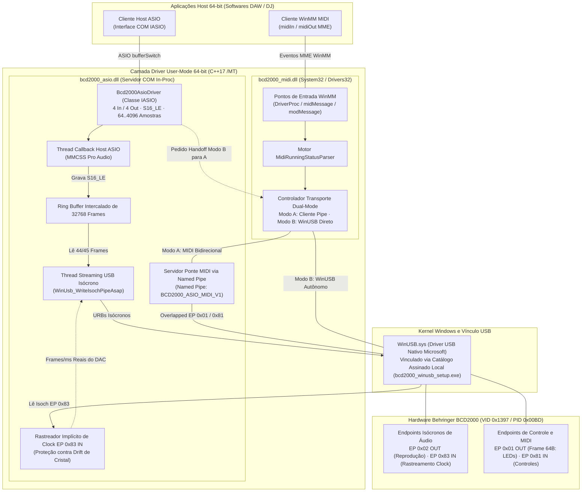

[ English](../../TECHNICS.md) | [ Español](TECHNICS.es.md) | [ **Português**](TECHNICS.pt.md) | [ Deutsch](TECHNICS.de.md) | [ Français](TECHNICS.fr.md) | [ 中文](TECHNICS.zh.md) | [ 日本語](TECHNICS.ja.md)

# Referência Técnica, Arquitetura e Guia de Desenvolvimento (`TECHNICS.pt.md`)

**Documentação detalhada de engenharia da suíte de drivers User-Mode ASIO e WinMM MIDI de 64 bits para a Behringer BCD2000.**

[Guia do Usuário (README.pt.md)](README.pt.md) · [Blueprint Histórico de Verificação](../ROADMAP_VERIFICATION.md) · [Guardrails para Agentes de IA (AGENTS.md)](../../AGENTS.md)

---

## 1. Visão Geral do Sistema e Decisões de Projeto

A **Behringer BCD2000** (`VID 0x1397`, `PID 0x00BD`) é um dispositivo **USB 1.1 Full-Speed (12 Mbps)** equipado com um **microcontrolador 8051**, controlador USB **TI TUSB3200** e codec **Cirrus Logic CS4220**. Seu firmware de fábrica expõe descritores USB proprietários que **não** são compatíveis com os padrões USB Audio Class (UAC) ou USB-MIDI.

Em vez de escrever um driver `.sys` em modo kernel, este projeto implementa uma **Arquitetura de Driver 100% User-Mode de 64 bits** sobre o driver nativo `WinUSB.sys` da Microsoft:

* **Sem barreiras de assinatura de kernel:** DLLs em modo usuário não exigem certificados EV/WHQL nem modo Test Signing no Windows 10/11 x64.
* **Zero dependências externas em runtime:** Compilado estritamente para `x64` (`C++17`) com runtime estático MSVC (`/MT` em [`CMakeLists.txt`](../../CMakeLists.txt)), garantindo que `bcd2000_asio.dll` e `bcd2000_midi.dll` nunca falhem em nenhuma DAW por falta de `VCRUNTIME140.dll` / `MSVCP140.dll`.
* **Gestão de largura de banda USB 1.1:** O barramento Full-Speed (12 Mbps) impõe limites rígidos de agendamento isócrono. A saída prioriza PCM de 4 canais e 16 bits (`ASIOSTInt16LSB`, 44,1 kHz: Canais 1-2 Master RCA + Canais 3-4 Fones Cue), desacoplado dos tamanhos de buffer ASIO por um ring buffer atômico e estabilizado por rastreamento implícito de clock do hardware.

### Identificadores e Endpoints Principais

| Parâmetro | Valor / Implementação |
| :--- | :--- |
| **USB Hardware ID** | `VID_1397&PID_00BD` |
| **GUID de Interface WinUSB** | `{DEE824EF-729B-4A0E-9C14-B7117D33A817}` |
| **Nome / CLSID ASIO** | `Behringer BCD2000 ASIO 64-bit` / `{B2D20000-1397-00BD-A510-000000000064}` |
| **Nome do Dispositivo WinMM MIDI** | `Behringer BCD2000 MIDI` (instalado em `System32` e `Drivers32`) |
| **Endpoints de Áudio** | EP `0x02` Isócrono OUT (4 ch S16_LE @ 44,1 kHz), EP `0x83` Isócrono IN (rastreamento implícito do clock DAC) |
| **Endpoints Controle / MIDI** | EP `0x01` OUT (pacotes de 64 bytes, LEDs e init), EP `0x81` IN (eventos MIDI Running Status) |
| **Named Pipes IPC** | `\\.\pipe\BCD2000_ASIO_MIDI_V1` (ponte MIDI bidirecional), `\\.\pipe\BCD2000_MIDI_CTRL_V1` (handoff WinUSB `'R' -> 'K'`) |

---

## 2. Diagrama de Arquitetura do Driver



---

## 3. Como Construímos o Driver: Fases de Engenharia

Este projeto evoluiu a partir da matriz incremental documentada em [`docs/ROADMAP_VERIFICATION.md`](../ROADMAP_VERIFICATION.md) até a suíte completa atual. Cada fase isolou um subsistema em uma ferramenta de diagnóstico antes da integração nas DLLs finais.

### Fase 1 — Enumeração USB e Handshake de Inicialização (`bcd2000_diag_usb.exe`)
* **Desafio:** A BCD2000 permanece inerte no USB até que o MCU 8051 receba uma sequência proprietária de 52 bytes no Endpoint `0x01`.
* **Implementação:** Descoberta via `SetupDiGetClassDevsW` (`kWinUsbGenericGuid` + `vid_1397` / `pid_00bd`), inicialização com `WinUsb_Initialize` e envio de `kInitSequence` (originada do driver Linux `snd-bcd2000`).
* **Validação:** Enumeração correta de interfaces/pipes e resposta visual de LEDs no hardware.

### Fase 2 — Telemetria de Controles, Running Status e Motor de LEDs (`bcd2000_diag_midi.exe`)
* **Desafio:** Pacotes no EP `0x81` IN usam **MIDI Running Status** de tamanho variável em transferências de 64 bytes, enquanto saídas de LEDs no EP `0x01` OUT exigem cabeçalho `[0x03, 0x00, len, ...]` sem bloquear leituras simultâneas.
* **Implementação:** `MidiRunningStatusParser` e `SendBcdMidiOverlapped` em [`src/common/bcd2000_usb_protocol.h`](../../src/common/bcd2000_usb_protocol.h), validando faders, knobs, jog wheels, botões e CCs de LEDs (`0xB0`, `CC 0x00..0x19`).

### Fase 3 — Streaming PCM Isócrono e Síntese Senoidal (`bcd2000_diag_audio.exe`)
* **Desafio:** Transmitir PCM de 4 canais e 16 bits (`8 bytes/frame` a 44,1 kHz) continuamente via USB 1.1 sem falhas de buffer sob o escalonador do Windows.
* **Implementação:** Pipeline multi-URB overlapped (`360 bytes/ms` máx., `16` pacotes/URB, `6` URBs simultâneos) com prioridade **MMCSS `"Pro Audio"`** (`avrt.dll` / `AVRT_PRIORITY_CRITICAL`), validado com tom senoidal puro de 440 Hz nas saídas Master RCA e Fones.

### Fase 4 — Servidor COM ASIO 64-bit e Rastreamento Implícito de Clock (`bcd2000_asio.dll`, `hostsample.exe`)
* **Desafio 1 (Geometria):** DAWs usam buffers potência de 2 (`64..4096`), enquanto o USB 1.1 opera em frames de 1 ms (`44,1 frames/ms`).
* **Desafio 2 (Drift de cristal):** Cadências fixas geram deriva frente ao cristal físico do DAC, causando cliques periódicos (~2–3 Hz).
* **Implementação:** Servidor COM x64 (`Bcd2000AsioDriver`, [`src/asio/dllmain_registry.cpp`](../../src/asio/dllmain_registry.cpp)) compatível com ASIO 2.3, **ring buffer de 32.768 frames** e **Rastreador Implícito de Clock no EP `0x83` IN** (`WinUsb_ReadIsochPipeAsap`) ajustando dinamicamente pacotes de `44`/`45` frames.

### Fase 5 — Driver WinMM MIDI 64-bit e Handoff Dual-Mode (`bcd2000_midi.dll`, `hostsample_midi.exe`)
* **Desafio:** `WinUSB.sys` concede **acesso exclusivo** a um único handle.
* **Implementação:** Transporte **Dual-Mode** entre [`src/midi/bcd2000_midi_driver.cpp`](../../src/midi/bcd2000_midi_driver.cpp) e [`src/asio/bcd2000_asio_driver.cpp`](../../src/asio/bcd2000_asio_driver.cpp): **Modo A** (cliente de `\\.\pipe\BCD2000_ASIO_MIDI_V1`) e **Modo B** (WinUSB autônomo com handoff `'R' -> 'K'` via `\\.\pipe\BCD2000_MIDI_CTRL_V1`) sem fechar handles WinMM abertos na DAW.

### Fase 6 — Instalador Zero-Zadig, Pacote NSIS e Preset Seguro para Mixxx
* **Vínculo WinUSB sem Zadig (`bcd2000_winusb_setup.exe`):** [`tools/bcd2000_winusb_setup.cpp`](../../tools/bcd2000_winusb_setup.cpp) cria e assina localmente `.inf`/`.cat` SHA-256 via `wintrust.dll` + `DiInstallDriverW`.
* **Instalador Único NSIS (`Behringer_BCD2000_Setup_x64.exe`):** [`installer/bcd2000_setup.nsi`](../../installer/bcd2000_setup.nsi) automatiza WinUSB, ASIO COM, `System32\bcd2000_midi.dll`, ferramentas e desinstalação.
* **Preset Seguro Mixxx (`presets/mixxx/`):** [`Behringer-BCD2000-safe-scripts.js`](../../presets/mixxx/Behringer-BCD2000-safe-scripts.js) omite o dump inicial (`0xB0 0x64 0x7F`) e aplica *soft-takeover*.

---

## 4. Configuração do Ambiente de Compilação

### Pré-requisitos (Bill of Materials)
1. **SO:** Windows 10 ou Windows 11 (x64).
2. **Compilador:** Visual Studio 2022 (ou Build Tools 2022) com **Desenvolvimento para Desktop com C++** (`cl.exe` destino **x64**, C++17).
3. **Windows SDK:** Windows 10/11 SDK (`10.0.19041.0` ou superior) com `winusb`, `setupapi`, `avrt`, `wintrust`, `crypt32`, `newdev`, `winmm` e `ole32`.
4. **Sistema de Build:** CMake `3.20` ou superior.
5. **SDK de Terceiros:** Steinberg ASIO SDK 2.3 em `third_party/asio-sdk/`.
6. **Ferramenta de Instalação (Opcional):** NSIS 3.x (`.tools/nsis/nsis-3.13/Bin` ou `PATH`) para habilitar o target `bcd2000_installer`.

### Configurar e Compilar (PowerShell)

```powershell
# 1. Configurar para 64-bit (x64 é estritamente exigido pelo CMakeLists.txt)
# A versão base padrão é 2.0.0; pode ser sobrescrita via -DBCD2000_VERSION="X.Y.Z"
cmake -B build -A x64 -DBCD2000_VERSION="2.0.0"

# 2. Compilar todas as DLLs e ferramentas de diagnóstico (Release ou RelWithDebInfo)
cmake --build build --config Release

# 3. (Opcional) Gerar o instalador NSIS em executável único
cmake --build build --config Release --target bcd2000_installer
```

Os binários compilados são gerados em `build\Release\` (ou `build\RelWithDebInfo\`).

### Registro e Testes Locais

```powershell
# Registrar o servidor COM ASIO (requer prompt de Administrador)
.\scripts\install_driver.ps1 -Config Release

# Executar ferramentas de verificação incremental de hardware/host
.\build\Release\bcd2000_diag_usb.exe
.\build\Release\bcd2000_diag_midi.exe
.\build\Release\bcd2000_diag_audio.exe --frequency 440 --duration 10
.\third_party\asio-sdk\host\pc\hostsample.exe
.\build\Release\hostsample_midi.exe

# Desregistrar o servidor COM ASIO
.\scripts\uninstall_driver.ps1 -Config Release
```

### Diagnóstico em Tempo Real e Mitigações
* **Log em Tempo Real:** Tanto `bcd2000_asio.dll` quanto `bcd2000_midi.dll` gravam eventos com timestamp (`pid`, `tid`, tag) via `bcd2000::TraceLog` em **`%TEMP%\bcd2000_trace.log`**.
* **Inspeção de Pacotes USB:** Use **Wireshark + USBPcap** para inspecionar frames de controle em EP `0x01` / `0x81` e URBs isócronos em EP `0x02` / `0x83`.
* **Mitigações comuns:**
  * *Falha ao abrir pipe WinUSB:* Execute `bcd2000_winusb_setup.exe` como Administrador e reconecte o cabo USB.
  * *Saturação USB 1.1 ou cortes de áudio:* Conecte a uma porta USB direta e use buffers múltiplos de `64` amostras (`256` ou `512` recomendados).
  * *Sem eventos de faders/botões:* Confirme se a sequência de 52 bytes `kInitSequence` foi enviada (`bcd2000_diag_usb.exe`).

---

## 5. Regras e Diretrizes para Colaboradores

Contribuições são calorosamente bem-vindas: Pull Requests, relatórios de bugs, testes em diferentes controladores USB/Windows e novos presets para DAWs/DJ softwares! Para manter o driver robusto, siga estas regras:

### Invariantes de Arquitetura
1. **Estritamente 64-bit User-Mode:** Nunca adicione drivers `.sys` de kernel nem targets de 32 bits (`CMakeLists.txt` aborta intencionalmente compilações que não sejam x64).
2. **Manter CRT Estático (`/MT`):** Não altere `CMAKE_MSVC_RUNTIME_LIBRARY` para `/MD`. As DLLs carregadas em DAWs de terceiros devem ser totalmente independentes.
3. **Segurança em Tempo Real:** Dentro de `AsioHostThreadMain` e `UsbStreamingThreadMain`, **nunca** faça alocações no heap, use locks bloqueantes que concorram com UI/IPC nem I/O síncrona de arquivos.
4. **Fonte Única do Protocolo:** Mantenha VID/PID, `kInitSequence`, nomes de pipes, `MidiRunningStatusParser` e utilitários de pacotes centralizados em [`src/common/bcd2000_usb_protocol.h`](../../src/common/bcd2000_usb_protocol.h).
5. **Preservar o Handoff Dual-Mode:** Qualquer alteração no WinUSB deve manter o protocolo `'R' -> 'K'` sem fechar handles WinMM ativos no DAW.
6. **Entrega Contínua e SemVer (v2.0.0+):** Cada atualização na branch `main` dispara compilação, empacotamento NSIS e versionamento automatizado no GitHub Actions ([`.github/workflows/release.yml`](../../.github/workflows/release.yml)). A versão base inicia em `v2.0.0` para evitar conflitos com os drivers originais de 32 bits da Behringer (`v1.x`). Mensagens de commit guiam o versionamento: commits comuns geram incremento `patch`, `feat:` / `#minor` geram `minor`, e `BREAKING CHANGE:` / `#major` geram `major`.

### Estilo de Código e Checklist de PR
* **C++17 estrito:** Deve compilar sem novos warnings em `/W4 /permissive- /utf-8`.
* **Verificação de Build Obrigatória:** Confirme compilação limpa em `RelWithDebInfo` e `Release` (x64) antes de abrir um PR.
* **Verificação Funcional:**
  * Alterações em ASIO COM / áudio: teste com `hostsample.exe` e pelo menos uma DAW x64 real (REAPER, Ableton Live ou Mixxx).
  * Alterações em WinMM MIDI / ponte IPC: teste `hostsample_midi.exe` e transições simultâneas de início/fim de áudio e MIDI.
* **Sincronização Documental:** Se o PR alterar comportamento visível, etapas de build ou presets, atualize [`README.pt.md`](README.pt.md) / [`TECHNICS.pt.md`](TECHNICS.pt.md) (e todas as traduções em `docs/i18n/`).
* **Guardrails para Agentes de IA:** Assistentes automatizados e agentes de IA devem revisar e cumprir rigorosamente [`AGENTS.md`](../../AGENTS.md).

---

## 9. Arquitetura de Licenciamento e Conformidade Jurídica

O Behringer BCD2000 64-bit ASIO and MIDI Driver Suite é distribuído como Software Livre sob a **[GNU General Public License v3 ou posterior (GPL-3.0-or-later)](../../LICENSE)**, acrescida da **Exceção de Vinculação para Hosts e DAWs** (Seção 7 da GPLv3).

### 9.1. Definições Limpas da ABI ASIO e Exceção para Hosts
* **Definições ABI Clean-Room:** Os cabeçalhos em [`third_party/asio-sdk/common`](../../third_party/asio-sdk/common) (`asio.h`, `iasiodrv.h`) são declarações limpas e independentes da especificação pública COM para Steinberg ASIO 2.3. Não incorporam nem redistribuem código proprietário do SDK da Steinberg.
* **Exceção para Hosts ASIO:** Conforme a Seção 7 da GPLv3, é concedida permissão explícita para vincular dinamicamente e carregar `bcd2000_asio.dll` e `bcd2000_midi.dll` via interface COM IASIO e WinMM MME a partir de qualquer software anfitrião (Mixxx, Ableton Live, FL Studio, REAPER, Traktor, etc.) sem impor restrições ou licenças sobre a aplicação hospedeira.
* **Aviso de Marca:** ASIO é marca registrada e software da Steinberg Media Technologies GmbH.

### 9.2. Referências de Terceiros e Bibliotecas do Sistema
* **Engenharia Reversa no Linux ALSA (`snd-bcd2000`):** O handshake de 52 bytes (`kInitSequence`) foi obtido a partir da análise do driver ALSA de Mario Kicherer (`GPL-2.0`). Parâmetros de protocolo e sequências de hardware são usados para fins de interoperabilidade técnica.
* **Mapeamento Seguro do Mixxx:** Os scripts e presets em [`presets/mixxx`](../../presets/mixxx) são baseados no mapeamento original de Golzo e do Mixxx Development Team (`GPL-2.0-or-later`), plenamente compatíveis com a GPL-3.0-or-later.
* **Exceção de System Libraries do Windows:** O driver depende de componentes do Windows (`WinUSB.sys`), do Windows SDK e da biblioteca estática de tempo de execução do MSVC (`/MT`). Sob a Seção 1 da GPLv3, qualificam-se como Bibliotecas do Sistema, autorizando a distribuição de binários compilados x64.
* **Créditos:** A lista completa de autores e créditos de engenharia reversa encontra-se em [`AUTHORS`](../../AUTHORS).

---

---

[ English](../../TECHNICS.md) | [ Español](TECHNICS.es.md) | [ **Português**](TECHNICS.pt.md) | [ Deutsch](TECHNICS.de.md) | [ Français](TECHNICS.fr.md) | [ 中文](TECHNICS.zh.md) | [ 日本語](TECHNICS.ja.md)
